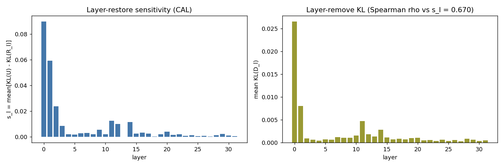
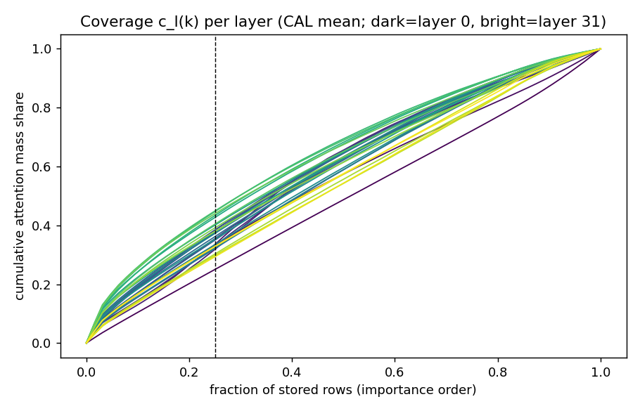
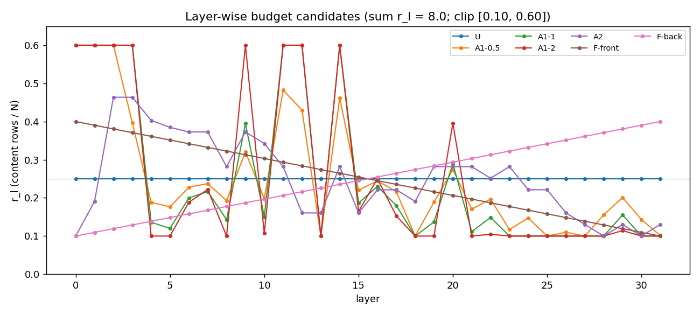

# Layer-wise budget allocation for PrefixStore-KV25 (LLaVA-NeXT) — results

Run `/home/dblab/hj/mllm_v2/runs/layer_budget_kv25_20261105T125754Z`. Contract [CONTRACT.md](CONTRACT.md) (SHA `12993920bcf3f9f2…`, frozen before measurement). Model llava-v1.6-vicuna-7b NF4/BF16/eager, FP16 SSD KV, 64-row chunks, greedy max 16, seed 1234.

## Decision: **PARTIAL**

HOLD followup accuracy, B-A1-2 − B-uniform: **+1.305 pp** [+0.560, +2.046] (image-cluster paired bootstrap, 10,000 resamples, seed 1234; CI excludes 0). SSD MB/followup 308.050 vs uniform 308.050 (OK ≤1.02×); TTFT mean 279.80 vs 248.94 ms (VIOLATED ≤1.05×). Independent audit: PASS; final = True.

## Gates

| Gate | Result |
|---|---|
| cpu_tests | PASS |
| g3_budget_invariance | PASS |
| gpu_gates | PASS |
| G3 DEV byte invariance (max |ratio−1|) | 0.000000 (tol 0.02) PASS |
| Artifact protection before/after | PASS (explained by recorded amendment: mmimpress/serve.py) |

Failed gate attempts preserved (harness fixes, no threshold change): gpu_gates_attempt1_failed, gpu_gates_attempt2_failed. See the run's `gate_gpu_attempt*_failed.log`.

## Data split

| Role | Source | Images / questions | Overlap |
|---|---|---|---|
| CAL | VQAv2 250-image workload | 250 / 1250 | CAL∩DEV 0, CAL∩HOLD 0 |
| DEV | GQA 40 × questions[4:10] | 40 / 240 | DEV∩HOLD 40 |
| HOLD | MT-GQA-reconstructed | 398 / 4061 dialogues, 12183 req/arm | — |
| (rejected) GQA-large | data/gqa_large | 395 | CAL∩HOLD 395 → 0 remain |

## Phase 1 — layer sensitivity (CAL)

1250 questions / 250 images; per-variant forward 38.8 ms. Mean KL(FULL‖U) = 0.1403. Spearman ρ between s_l (restore) and KL(D_l) (remove) rankings = 0.670; layers with s_l > 0: 31/32. CAL accuracy FULL EM 70.320 %, U EM 65.440 % (VQA soft 80.133 / 75.947 %).

| layer | s_l | KL(R_l) | KL(D_l) | Δ first-token gold match R−U (pp) |
|---|---|---|---|---|
| 0 | 0.0900 | 0.0503 | 0.0266 | 2.0800 |
| 1 | 0.0594 | 0.0809 | 0.0080 | 1.6800 |
| 2 | 0.0238 | 0.1165 | 0.0009 | 1.1200 |
| 3 | 0.0085 | 0.1318 | 0.0006 | 0.4000 |
| 4 | 0.0019 | 0.1384 | 0.0004 | 0.2400 |
| 5 | 0.0017 | 0.1386 | 0.0007 | 0.0800 |
| 6 | 0.0028 | 0.1375 | 0.0006 | -0.1600 |
| 7 | 0.0030 | 0.1372 | 0.0012 | 0.0800 |
| 8 | 0.0020 | 0.1383 | 0.0011 | 0.4000 |
| 9 | 0.0055 | 0.1347 | 0.0011 | 0.4000 |
| 10 | 0.0021 | 0.1382 | 0.0015 | -0.3200 |
| 11 | 0.0126 | 0.1277 | 0.0047 | 0.5600 |
| 12 | 0.0100 | 0.1303 | 0.0019 | 0.4800 |
| 13 | 0.0000 | 0.1404 | 0.0014 | 0.0000 |
| 14 | 0.0115 | 0.1288 | 0.0028 | 0.4000 |
| 15 | 0.0026 | 0.1377 | 0.0011 | 0.0000 |
| 16 | 0.0032 | 0.1371 | 0.0007 | 0.0000 |
| 17 | 0.0025 | 0.1378 | 0.0008 | -0.0800 |
| 18 | 0.0004 | 0.1399 | 0.0007 | 0.0800 |
| 19 | 0.0019 | 0.1384 | 0.0010 | 0.3200 |
| 20 | 0.0041 | 0.1362 | 0.0011 | 0.2400 |
| 21 | 0.0016 | 0.1387 | 0.0005 | 0.4000 |
| 22 | 0.0021 | 0.1382 | 0.0006 | 0.3200 |
| 23 | 0.0007 | 0.1395 | 0.0004 | 0.2400 |
| 24 | 0.0012 | 0.1391 | 0.0007 | 0.4000 |
| 25 | 0.0004 | 0.1398 | 0.0004 | -0.0800 |
| 26 | 0.0007 | 0.1396 | 0.0005 | -0.2400 |
| 27 | 0.0003 | 0.1400 | 0.0003 | 0.1600 |
| 28 | 0.0013 | 0.1390 | 0.0009 | 0.2400 |
| 29 | 0.0022 | 0.1381 | 0.0007 | 0.2400 |
| 30 | 0.0011 | 0.1392 | 0.0004 | -0.0800 |
| 31 | 0.0006 | 0.1397 | 0.0005 | 0.3200 |

## Phase 2 — allocation vectors (Σ r_l = 8.0, clip [0.10, 0.60])

| layer | U | A1-0.5 | A1-1 | A1-2 | A2 | F-front | F-back |
|---|---|---|---|---|---|---|---|
| 0 | 0.250000 | 0.600000 | 0.600000 | 0.600000 | 0.100000 | 0.400000 | 0.100000 |
| 1 | 0.250000 | 0.600000 | 0.600000 | 0.600000 | 0.190909 | 0.390323 | 0.109677 |
| 2 | 0.250000 | 0.600000 | 0.600000 | 0.600000 | 0.463636 | 0.380645 | 0.119355 |
| 3 | 0.250000 | 0.397291 | 0.600000 | 0.600000 | 0.463636 | 0.370968 | 0.129032 |
| 4 | 0.250000 | 0.188211 | 0.136178 | 0.100000 | 0.403030 | 0.361290 | 0.138710 |
| 5 | 0.250000 | 0.176644 | 0.119954 | 0.100000 | 0.384848 | 0.351613 | 0.148387 |
| 6 | 0.250000 | 0.227937 | 0.199731 | 0.188516 | 0.372727 | 0.341935 | 0.158065 |
| 7 | 0.250000 | 0.237446 | 0.216743 | 0.221999 | 0.372727 | 0.332258 | 0.167742 |
| 8 | 0.250000 | 0.192784 | 0.142875 | 0.100000 | 0.281818 | 0.322581 | 0.177419 |
| 9 | 0.250000 | 0.320556 | 0.395024 | 0.600000 | 0.372727 | 0.312903 | 0.187097 |
| 10 | 0.250000 | 0.197879 | 0.150526 | 0.107074 | 0.342424 | 0.303226 | 0.196774 |
| 11 | 0.250000 | 0.482253 | 0.600000 | 0.600000 | 0.281818 | 0.293548 | 0.206452 |
| 12 | 0.250000 | 0.429940 | 0.600000 | 0.600000 | 0.160606 | 0.283871 | 0.216129 |
| 13 | 0.250000 | 0.100000 | 0.100000 | 0.100000 | 0.160606 | 0.274194 | 0.225806 |
| 14 | 0.250000 | 0.461887 | 0.600000 | 0.600000 | 0.281818 | 0.264516 | 0.235484 |
| 15 | 0.250000 | 0.220309 | 0.186586 | 0.164520 | 0.160606 | 0.254839 | 0.245161 |
| 16 | 0.250000 | 0.244649 | 0.230091 | 0.250184 | 0.221212 | 0.245161 | 0.254839 |
| 17 | 0.250000 | 0.216321 | 0.179893 | 0.152927 | 0.221212 | 0.235484 | 0.264516 |
| 18 | 0.250000 | 0.100000 | 0.100000 | 0.100000 | 0.190909 | 0.225806 | 0.274194 |
| 19 | 0.250000 | 0.188848 | 0.137101 | 0.100000 | 0.281818 | 0.216129 | 0.283871 |
| 20 | 0.250000 | 0.274409 | 0.289474 | 0.395985 | 0.281818 | 0.206452 | 0.293548 |
| 21 | 0.250000 | 0.170379 | 0.111595 | 0.100000 | 0.281818 | 0.196774 | 0.303226 |
| 22 | 0.250000 | 0.196716 | 0.148763 | 0.104580 | 0.251515 | 0.187097 | 0.312903 |
| 23 | 0.250000 | 0.117062 | 0.100000 | 0.100000 | 0.281818 | 0.177419 | 0.322581 |
| 24 | 0.250000 | 0.147258 | 0.100000 | 0.100000 | 0.221212 | 0.167742 | 0.332258 |
| 25 | 0.250000 | 0.100000 | 0.100000 | 0.100000 | 0.221212 | 0.158065 | 0.341935 |
| 26 | 0.250000 | 0.109857 | 0.100000 | 0.100000 | 0.160606 | 0.148387 | 0.351613 |
| 27 | 0.250000 | 0.100000 | 0.100000 | 0.100000 | 0.130303 | 0.138710 | 0.361290 |
| 28 | 0.250000 | 0.155611 | 0.100000 | 0.100000 | 0.100000 | 0.129032 | 0.370968 |
| 29 | 0.250000 | 0.201098 | 0.155465 | 0.114215 | 0.130303 | 0.119355 | 0.380645 |
| 30 | 0.250000 | 0.143326 | 0.100000 | 0.100000 | 0.100000 | 0.109677 | 0.390323 |
| 31 | 0.250000 | 0.101326 | 0.100000 | 0.100000 | 0.130303 | 0.100000 | 0.400000 |

SHA256: U `54ea273e1a38…`, A1-0.5 `8b3ee44bc6f2…`, A1-1 `db0354145518…`, A1-2 `2c2295cfbe87…`, A2 `9d2846ced0d2…`, F-front `d4314f59fc8e…`, F-back `a6b5884a2102…`. 

## Phase 3 — DEV (40 images × 5 cache hits per arm = 200 hits; T1 shared)

| Arm | Hit acc. % | All acc. % | Δ vs U (pp) [95% CI] | Δ vs FullLoad (pp) [95% CI] | Pred. agreement vs FullLoad |
|---|---|---|---|---|---|
| recompute | 63.000 | 62.500 | +6.50 [+1.50, +12.00] | +0.00 [-2.00, +2.00] | 98.000 |
| fullload | 63.000 | 62.500 | +6.50 [+1.50, +12.00] | — | 100.000 |
| U | 56.500 | 57.083 | — | -6.50 [-12.00, -1.50] | 82.000 |
| A1-0.5 | 58.500 | 58.750 | +2.00 [-2.50, +6.50] | -4.50 [-9.00, +0.00] | 85.500 |
| A1-1 | 59.000 | 59.167 | +2.50 [-1.50, +7.00] | -4.00 [-8.50, +0.50] | 87.000 |
| A1-2 | 59.500 | 59.583 | +3.00 [-2.00, +8.00] | -3.50 [-8.00, +0.50] | 86.500 |
| A2 | 50.000 | 51.667 | -6.50 [-12.00, -1.00] | -13.00 [-19.50, -7.00] | 68.000 |
| F-front | 56.500 | 57.083 | +0.00 [-3.50, +3.50] | -6.50 [-11.50, -2.00] | 85.000 |
| F-back | 34.000 | 38.333 | -22.50 [-32.50, -13.00] | -29.00 [-39.00, -19.00] | 48.500 |

| Arm | TTFT mean / p50 / p95 ms | E2E mean ms | SSD MB/hit | preads |
|---|---|---|---|---|
| recompute | 523.8 / 528.1 / 611.0 | 550.1 | 0.00 | 0.0 |
| fullload | 667.9 / 669.4 / 828.0 | 695.5 | 1165.07 | 64.0 |
| U | 209.2 / 209.3 / 242.9 | 236.7 | 306.29 | 65.0 |
| A1-0.5 | 238.4 / 238.1 / 279.6 | 266.1 | 306.29 | 65.0 |
| A1-1 | 240.4 / 241.4 / 280.6 | 268.0 | 306.29 | 65.0 |
| A1-2 | 243.1 / 242.9 / 287.8 | 270.6 | 306.29 | 65.0 |
| A2 | 223.7 / 223.6 / 255.6 | 252.1 | 306.29 | 65.0 |
| F-front | 218.2 / 217.0 / 256.4 | 245.9 | 306.29 | 65.0 |
| F-back | 219.3 / 218.2 / 261.7 | 280.7 | 306.29 | 65.0 |

| Arm | Store MB/image | Persistence ms | Activation ms | OS write MB |
|---|---|---|---|---|
| fullload | 1260.58 | 1776.6 | 619.8 | 1260.58 |
| U | 309.02 | 622.8 | 157.6 | 309.02 |
| A1-0.5 | 309.03 | 628.5 | 157.8 | 309.03 |
| A1-1 | 309.03 | 633.3 | 157.7 | 309.03 |
| A1-2 | 309.03 | 631.9 | 157.3 | 309.03 |
| A2 | 309.02 | 628.9 | 156.9 | 309.02 |
| F-front | 309.02 | 628.9 | 156.9 | 309.02 |
| F-back | 309.02 | 622.7 | 156.7 | 309.02 |

Question-type Δ vs FullLoad on hits (pp), spatial highlighted:

| type | n | U | A1-0.5 | A1-1 | A1-2 | A2 | F-front | F-back |
|---|---|---|---|---|---|---|---|---|
| all | 200 | -6.5 | -4.5 | -4.0 | -3.5 | -13.0 | -6.5 | -29.0 |
| color | 10 | -10.0 | -10.0 | -10.0 | -10.0 | -40.0 | -10.0 | -60.0 |
| material/attribute | 8 | +25.0 | +37.5 | +37.5 | +25.0 | -12.5 | +12.5 | -12.5 |
| object | 50 | -8.0 | -10.0 | -10.0 | -6.0 | -10.0 | -10.0 | -20.0 |
| other | 6 | +0.0 | +0.0 | +0.0 | +0.0 | -16.7 | +0.0 | -66.7 |
| **spatial** | 43 | -9.3 | -7.0 | -7.0 | -7.0 | -11.6 | -2.3 | -23.3 |
| yes/no | 83 | -7.2 | -3.6 | -2.4 | -2.4 | -12.0 | -8.4 | -32.5 |

**SELECTED = A1-2** (rule: max DEV hit accuracy; ties -> A2, A1-1, A1-0.5, A1-2; F-front admitted if within +-0.5 pp); F-front − SELECTED = -3.00 pp → F-front not admitted. HOLD arms: ['recompute', 'fullload', 'ours_prefixstore_kv25', 'ours_prefixstore_kv25_layerwise_A1-2'].

## Phase 4 — HOLD (MT-GQA-reconstructed, 398 images, 4,061 dialogues × 3 turns, generated history)

Independent audit PASS: 48732 / 48732 requests, 398 / 398 images.

| Method | T1 % | T2 % | T3 % | All % (correct/N) | Followup % (correct/N) |
|---|---|---|---|---|---|
| ReComp | 63.186 | 68.111 | 68.850 | 66.716 (8128/12183) | 68.481 (5562/8122) |
| FullLoad | 63.186 | 68.062 | 68.702 | 66.650 (8120/12183) | 68.382 (5554/8122) |
| B-uniform | 63.186 | 65.698 | 66.658 | 65.181 (7941/12183) | 66.178 (5375/8122) |
| B-A1-2 | 63.186 | 67.126 | 67.840 | 66.051 (8047/12183) | 67.483 (5481/8122) |

| a − b | Scope | Δ pp [95% CI] | a-only / b-only / both / neither | Pred. agreement |
|---|---|---|---|---|
| B-A1-2 − B-uniform | followup | +1.305 [+0.560, +2.046] | 373 / 267 / 5108 / 2374 | 88.845 |
| B-A1-2 − B-uniform | all | +0.870 [+0.373, +1.364] | 373 / 267 / 7674 / 3869 | 92.563 |
| B-A1-2 − ReComp | followup | -0.997 [-1.663, -0.341] | 220 / 301 / 5261 / 2340 | 90.803 |
| B-A1-2 − ReComp | all | -0.665 [-1.109, -0.228] | 220 / 301 / 7827 / 3835 | 93.869 |
| B-A1-2 − FullLoad | followup | -0.899 [-1.588, -0.249] | 229 / 302 / 5252 / 2339 | 90.557 |
| B-A1-2 − FullLoad | all | -0.599 [-1.059, -0.166] | 229 / 302 / 7818 / 3834 | 93.704 |
| B-uniform − ReComp | followup | -2.302 [-3.052, -1.540] | 297 / 484 / 5078 / 2263 | 86.727 |
| B-uniform − ReComp | all | -1.535 [-2.035, -1.027] | 297 / 484 / 7644 / 3758 | 91.152 |
| B-uniform − FullLoad | followup | -2.204 [-2.951, -1.451] | 307 / 486 / 5068 / 2261 | 86.543 |
| B-uniform − FullLoad | all | -1.469 [-1.968, -0.967] | 307 / 486 / 7634 / 3756 | 91.028 |

| Method | TTFT mean / p50 / p95 ms | E2E mean / p50 / p95 ms | K / V / struct MB | SSD MB/followup | preads |
|---|---|---|---|---|---|
| ReComp | 529.27 / 532.41 / 594.68 | 557.79 / 559.88 / 643.57 | 0.00 / 0.00 / 0.00 | 0.00 | 0.00 |
| FullLoad | 736.50 / 738.25 / 858.58 | 765.50 / 765.95 / 899.86 | 586.96 / 586.96 / 0.00 | 1173.92 | 64.00 |
| B-uniform | 248.94 / 249.38 / 285.42 | 278.04 / 275.92 / 326.87 | 144.31 / 144.31 / 19.43 | 308.05 | 65.00 |
| B-A1-2 | 279.80 / 282.41 / 315.16 | 308.95 / 310.49 / 356.95 | 144.31 / 144.31 / 19.43 | 308.05 | 65.00 |

| Method | Stored content % | Store MB mean / p50 / p95 | OS write MB | Persistence ms mean / p95 | Activation ms mean / p95 |
|---|---|---|---|---|---|
| FullLoad | 100.000 | 1264.67 / 1304.80 / 1382.31 | 1264.67 | 1629.2 / 2192.0 | 1223.3 / 1343.3 |
| B-uniform | 25.000 | 309.68 / 320.45 / 338.02 | 309.68 | 618.3 / 802.0 | 161.5 / 180.7 |
| B-A1-2 | 25.000 | 309.68 / 320.46 / 338.03 | 309.68 | 602.0 / 792.6 | 163.4 / 182.1 |

| Method | Shared-stream session mean / p50 / p95 ms | Standalone-equivalent mean / p50 / p95 ms | Provenance |
|---|---|---|---|
| ReComp | 1665.8 / 1697.0 / 1893.5 | 1665.8 / 1697.0 / 1893.5 | MEASURED_NO_KV_SETUP |
| FullLoad | 2362.0 / 2112.6 / 5019.0 | 4956.6 / 5006.1 / 5919.4 | MEASURED (shared) / DERIVED (standalone) |
| B-uniform | 1183.3 / 1125.3 / 1903.7 | 1886.8 / 1889.2 / 2251.6 | MEASURED (shared) / DERIVED (standalone) |
| B-A1-2 | 1243.2 / 1193.0 / 1946.9 | 1933.8 / 1942.9 / 2272.6 | MEASURED (shared) / DERIVED (standalone) |

| a − b | Scope / metric | Δ [95% CI] |
|---|---|---|
| B-A1-2 − B-uniform | followup / ttft_ms | +30.855 [+29.707, +31.972] |
| B-A1-2 − B-uniform | followup / request_e2e_ms | +30.910 [+29.745, +32.049] |
| B-A1-2 − B-uniform | followup / ssd_read_bytes | +0.000 [+0.000, +0.000] |
| B-A1-2 − ReComp | followup / ttft_ms | -249.474 [-254.768, -244.402] |
| B-A1-2 − ReComp | followup / request_e2e_ms | -248.834 [-254.079, -243.771] |
| B-A1-2 − ReComp | followup / ssd_read_bytes | +308049732.901 [+304173517.804, +311984792.205] |
| B-A1-2 − FullLoad | followup / ttft_ms | -456.699 [-463.630, -450.130] |
| B-A1-2 − FullLoad | followup / request_e2e_ms | -456.549 [-463.482, -450.000] |
| B-A1-2 − FullLoad | followup / ssd_read_bytes | -865869184.536 [-876788752.815, -854999351.081] |
| B-uniform − ReComp | followup / ttft_ms | -280.330 [-285.697, -274.960] |
| B-uniform − ReComp | followup / request_e2e_ms | -279.744 [-285.109, -274.368] |
| B-uniform − ReComp | followup / ssd_read_bytes | +308049732.901 [+304173517.804, +311984792.205] |
| B-uniform − FullLoad | followup / ttft_ms | -487.555 [-494.482, -480.927] |
| B-uniform − FullLoad | followup / request_e2e_ms | -487.458 [-494.348, -480.900] |
| B-uniform − FullLoad | followup / ssd_read_bytes | -865869184.536 [-876788752.815, -854999351.081] |
| FullLoad − ReComp | session_shared / session_ms | +696.265 [+681.360, +712.586] |
| FullLoad − ReComp | session_standalone / session_ms | +3290.804 [+3247.512, +3335.144] |
| B-uniform − ReComp | session_shared / session_ms | -482.462 [-493.221, -471.337] |
| B-uniform − ReComp | session_standalone / session_ms | +220.979 [+211.916, +231.239] |
| B-A1-2 − ReComp | session_shared / session_ms | -422.570 [-433.122, -412.051] |
| B-A1-2 − ReComp | session_standalone / session_ms | +268.003 [+259.796, +276.486] |

## Limits and NOT_MEASURED

- Paired CIs: seed 1234, 10,000 image-cluster bootstrap resamples; a CI containing 0 is not equivalence. DEV has 40 image clusters and all DEV images are inside HOLD (different questions).
- Phase 1 R/D variants use first-token KL/NLL/argmax proxies; only FULL and U were fully decoded. CAL gold is the VQAv2 majority answer.
- Layerwise stores keep LLaVA's dense GPU buffer; no GPU-memory reduction is claimed. H2D bytes, independent GPU footprint, non-source T1 capture increment and NAND-level coldness are NOT_MEASURED. Qwen2.5-VL and GLM were not run.
- Existing sources modified before the run (recorded with diffs in the run): mmimpress/prefix25.py, mmimpress/serve.py, mmimpress/piggyback.py, mmimpress/store.py.

## Execution record (added after the generated report; no numbers above changed)

- HOLD main: 2026-11-05 14:40:41Z → 23:02:26Z UTC, 8 h 22 min, 48,732 / 48,732 requests (4 arms × 12,183), 398 images, 0 failures, 0 skips, no resume. Smoke 48/48 before it.
- Phase 1: ~56 min (1,250 CAL questions, 66 variant forwards each). DEV: ~18 min (9 arms × 240 requests). Gates + Phase 2: ~3 min. Report + audit: ~7 min.
- Failed attempts kept, all harness fixes without threshold changes: Phase-1 probe OOM (autograd enabled), CPU gate attempt 1 (serve.py chunk-budget regression → recorded freeze amendment; GLM modules pre-existing env errors), GPU gate attempts 1–2 (meta label key, k_per_layer lookup).
- TTFT violation root cause (why PARTIAL, not GO): identical bytes and preads, but cold pread throughput falls with file size (~2.0 GB/s at ~2 MB vs ~3.6–4.0 GB/s at 5–6 MB, read_ahead_kb 128); A1-2 concentrates rows in layers 0–2 and shrinks mid/back-layer files. Diagnostic: `llava/dev_io_diagnostic_pread_by_size.json`. The serving I/O path was left unchanged per contract.
- Details: [execution_record.json](execution_record.json).
