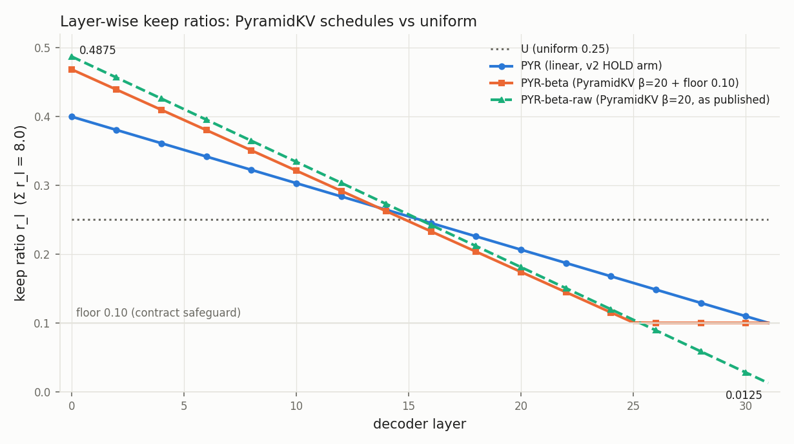

# PyramidKV(β=20) layer 배분 — MT-GQA HOLD 추가 실행 결과 (PYR-beta, PYR-beta-raw vs U_packed)

Run `runs/layer_budget_kv25_pyrbeta_20261110T073604Z`. 계약 [CONTRACT.md](CONTRACT.md) (SHA `fda3a5675ec9d916…`, 측정 전 freeze). 부모 run: v2 `results/layer_budget_kv25_v2_20261106T073502Z` (판정 GO). 모델 llava-v1.6-vicuna-7b NF4/BF16/eager, FP16 SSD KV, greedy max 16, seed 1234. 데이터로 벡터를 만들거나 고르는 과정은 없다.

## 반드시 알아야 할 정의

- **PYR-beta-raw** = PyramidKV 공개 코드 식(β=20, window 0)의 layer 비율 그대로(하한 없음, 문서 r_min = 0.0). **PYR-beta** = 같은 식에 우리 계약 하한 0.10을 적용한 것(v2에서 freeze한 벡터). 하한 0.10은 v1 설계에서 정한 안전장치이며 이번 실험 전까지 실험·선행 연구 근거가 없었다.
- 원 PyramidKV는 attention 기반 token 선택을 함께 쓰지만, 여기서는 image-only VisionZip 순서를 그대로 두고 layer별 자르는 지점만 PyramidKV를 따랐다.
- v2의 `PYR`은 선형 schedule(v1 F-front, 0.40 → 0.10)이며 두 PYR-beta와 다른 벡터다.
- 모든 arm은 같은 바이트·같은 packed I/O 경로(hit당 preadv 1회)·같은 token 순서를 쓰고 layer별 자르는 지점만 다르다.

## 판정

주 판정(사전 고정, 같은 실행 안, 벡터 − U_packed, HOLD followup, 이미지 단위 paired bootstrap 10,000회, seed 1234):

| 벡터 | 판정 | Δ pp [95% CI] | CI의 0 | SSD MB/followup (벡터 / U, ≤1.02×) | TTFT 평균 ms (벡터 / U, ≤1.05×) |
|---|---|---|---|---|---|
| PYR-beta | **GO** | +1.244 [+0.600, +1.896] | 제외 | 308.050 / 308.050 (OK) | 226.64 / 230.34 = 0.984× (OK) |
| PYR-beta-raw | **GO** | +1.244 [+0.624, +1.864] | 제외 | 308.050 / 308.050 (OK) | 226.84 / 230.34 = 0.985× (OK) |

하한 효과 판정(사전 고정): **FLOOR_UNNECESSARY** — 하한 불필요: D의 95% CI가 0을 포함한다. 논문 기본안은 PYR-beta-raw(PyramidKV 원식 그대로)이다. (D = +0.000 pp [-0.314, +0.307]) 논문 기본안: **PYR-beta-raw**. (raw만 정답 68 / floor만 정답 68 / 둘 다 5408 / 둘 다 오답 2578, 예측 일치율 97.710%)

독립 감사: PASS — 36,549 / 36,549 요청, 398 / 398 이미지, 감사 검사 3,691,759건, 실패 0. final = True.

## Gate

| Gate | 결과 |
|---|---|
| cpu_tests | PASS |
| g3_budget_invariance | PASS |
| g_det_main | PASS |
| g_det_smoke | PASS |
| g_rmin_floor_propagation | PASS |
| gpu_gates | PASS |
| Artifact protection before/after | PASS |
| Deletion log (run-local scratch only) | PASS |

- G-det: smoke 12/12 토큰 일치, main 12,183/12,183 (100.0000%) → cross-run 정확도 비교 ALLOWED.
- G-rmin: raw 벡터 문서의 r_min = 0.0이 store meta·packed/unpacked writer·모든 validator·두 selector·164 감사 경로까지 전달됨을 확인했고, 같은 store의 meta에서 r_min만 0.10으로 바꾸면 모두 fail closed된다. store/serving 경로에서 전역 기본값 0.10에 기대는 호출은 발견되지 않아 소스 수정(freeze_amendment)은 없었다 (156/162의 감사 호출은 기본값을 쓰므로 raw 벡터에 쓸 수 없고, 164는 문서의 r_min을 넘긴다).

## HOLD 정확도 (MT-GQA-reconstructed, 398 images, 4,061 dialogues × 3 turns, generated history)

| Method | T1 % | T2 % | T3 % | All % (correct/N) | Followup % (correct/N) |
|---|---|---|---|---|---|
| U_packed | 63.186 | 65.698 | 66.658 | 65.181 (7941/12183) | 66.178 (5375/8122) |
| PYR-beta_packed | 63.186 | 66.905 | 67.939 | 66.010 (8042/12183) | 67.422 (5476/8122) |
| PYR-beta-raw_packed | 63.186 | 67.200 | 67.643 | 66.010 (8042/12183) | 67.422 (5476/8122) |

| a − b | Scope | Δ pp [95% CI] | a-only / b-only / both / neither | 예측 일치 % |
|---|---|---|---|---|
| PYR-beta_packed − U_packed | followup | +1.244 [+0.600, +1.896] | 315 / 214 / 5161 / 2432 | 90.877 |
| PYR-beta_packed − U_packed | all | +0.829 [+0.400, +1.264] | 315 / 214 / 7727 / 3927 | 93.918 |
| PYR-beta_packed − U_packed | T1 | +0.000 [+0.000, +0.000] | 0 / 0 / 2566 / 1495 | 100.000 |
| PYR-beta-raw_packed − U_packed | followup | +1.244 [+0.624, +1.864] | 312 / 211 / 5164 / 2435 | 91.024 |
| PYR-beta-raw_packed − U_packed | all | +0.829 [+0.416, +1.243] | 312 / 211 / 7730 / 3930 | 94.016 |
| PYR-beta-raw_packed − U_packed | T1 | +0.000 [+0.000, +0.000] | 0 / 0 / 2566 / 1495 | 100.000 |
| PYR-beta-raw_packed − PYR-beta_packed | followup | +0.000 [-0.314, +0.307] | 68 / 68 / 5408 / 2578 | 97.710 |
| PYR-beta-raw_packed − PYR-beta_packed | all | +0.000 [-0.209, +0.205] | 68 / 68 / 7974 / 4073 | 98.473 |
| PYR-beta-raw_packed − PYR-beta_packed | T1 | +0.000 [+0.000, +0.000] | 0 / 0 / 2566 / 1495 | 100.000 |

## 지연·I/O (같은 실행 안, followup)

| Method | TTFT mean / p50 / p95 ms (× U) | E2E mean / p50 / p95 ms | read ms | scatter ms | prefill ms | SSD MB/followup | pread / preadv |
|---|---|---|---|---|---|---|---|
| U_packed | 230.34 / 231.42 / 269.01 (1.000×) | 259.29 / 257.43 / 310.65 | 97.3 | 86.7 | 40.4 | 308.05 | 0 / 1 |
| PYR-beta_packed | 226.64 / 227.18 / 269.67 (0.984×) | 255.63 / 253.63 / 304.06 | 97.2 | 83.1 | 40.4 | 308.05 | 0 / 1 |
| PYR-beta-raw_packed | 226.84 / 227.94 / 265.10 (0.985×) | 255.84 / 254.25 / 303.42 | 97.5 | 82.9 | 40.4 | 308.05 | 0 / 1 |

| a − b | Scope / metric | Δ [95% CI] |
|---|---|---|
| PYR-beta_packed − U_packed | followup / ttft_ms | -3.694 [-4.772, -2.605] |
| PYR-beta_packed − U_packed | followup / request_e2e_ms | -3.665 [-4.757, -2.576] |
| PYR-beta_packed − U_packed | followup / ssd_read_bytes | +0.000 [+0.000, +0.000] |
| PYR-beta-raw_packed − U_packed | followup / ttft_ms | -3.503 [-4.625, -2.374] |
| PYR-beta-raw_packed − U_packed | followup / request_e2e_ms | -3.454 [-4.574, -2.328] |
| PYR-beta-raw_packed − U_packed | followup / ssd_read_bytes | +0.000 [+0.000, +0.000] |
| PYR-beta-raw_packed − PYR-beta_packed | followup / ttft_ms | +0.191 [-0.712, +1.110] |
| PYR-beta-raw_packed − PYR-beta_packed | followup / request_e2e_ms | +0.211 [-0.696, +1.146] |
| PYR-beta-raw_packed − PYR-beta_packed | followup / ssd_read_bytes | +0.000 [+0.000, +0.000] |
| PYR-beta_packed − U_packed | session_shared / session_ms | -8.079 [-10.639, -5.561] |
| PYR-beta_packed − U_packed | session_standalone / session_ms | -12.826 [-22.320, -3.468] |
| PYR-beta-raw_packed − U_packed | session_shared / session_ms | -8.478 [-11.001, -6.018] |
| PYR-beta-raw_packed − U_packed | session_standalone / session_ms | -22.775 [-30.981, -14.696] |
| PYR-beta-raw_packed − PYR-beta_packed | session_shared / session_ms | -0.399 [-2.396, +1.678] |
| PYR-beta-raw_packed − PYR-beta_packed | session_standalone / session_ms | -9.949 [-16.737, -2.990] |

U_packed TTFT 평균: 이번 실행 230.34 ms vs v2 실행 212.06 ms (차이 +18.28 ms, 1.086×) — cross-run, 실행 간 변동 참고치이며 판정에 쓰지 않는다 (v2는 7 arm, 이번은 3 arm 회전).

## 부 판정 — v2 HOLD arm과의 cross-run 정확도 비교

cross-run, 결정성 확인됨 (U_packed 12,183 요청 토큰 단위 100% 일치). 요청 단위(dialog, turn)로 짝지은 이미지 단위 paired bootstrap. v2 followup 정확도: PYR_packed 67.114%, A1-2_packed 67.483%, VLC_offline_packed 67.052%, ReComp 68.481%, FullLoad 68.382%, U_packed 66.178%.

| a (이번 실행) − b (v2 실행) | Scope | Δ pp [95% CI] | a-only / b-only / both / neither | 예측 일치 % |
|---|---|---|---|---|
| PYR-beta_packed (this run) − PYR_packed (v2 run) | followup | +0.308 [-0.109, +0.715] | 117 / 92 / 5359 / 2554 | 96.023 |
| PYR-beta_packed (this run) − PYR_packed (v2 run) | all | +0.205 [-0.073, +0.477] | 117 / 92 / 7925 / 4049 | 97.349 |
| PYR-beta_packed (this run) − A1-2_packed (v2 run) | followup | -0.062 [-0.604, +0.469] | 185 / 190 / 5291 / 2456 | 93.241 |
| PYR-beta_packed (this run) − A1-2_packed (v2 run) | all | -0.041 [-0.402, +0.312] | 185 / 190 / 7857 / 3951 | 95.494 |
| PYR-beta_packed (this run) − VLC_offline_packed (v2 run) | followup | +0.369 [-0.037, +0.786] | 138 / 108 / 5338 / 2538 | 95.629 |
| PYR-beta_packed (this run) − VLC_offline_packed (v2 run) | all | +0.246 [-0.025, +0.524] | 138 / 108 / 7904 / 4033 | 97.086 |
| PYR-beta_packed (this run) − ReComp (v2 run) | followup | -1.059 [-1.691, -0.425] | 246 / 332 / 5230 / 2314 | 89.596 |
| PYR-beta_packed (this run) − ReComp (v2 run) | all | -0.706 [-1.127, -0.283] | 246 / 332 / 7796 / 3809 | 93.064 |
| PYR-beta_packed (this run) − FullLoad (v2 run) | followup | -0.960 [-1.600, -0.321] | 264 / 342 / 5212 / 2304 | 89.128 |
| PYR-beta_packed (this run) − FullLoad (v2 run) | all | -0.640 [-1.067, -0.214] | 264 / 342 / 7778 / 3799 | 92.752 |
| PYR-beta_packed (this run) − U_packed (v2 run) | followup | +1.244 [+0.600, +1.896] | 315 / 214 / 5161 / 2432 | 90.877 |
| PYR-beta_packed (this run) − U_packed (v2 run) | all | +0.829 [+0.400, +1.264] | 315 / 214 / 7727 / 3927 | 93.918 |
| PYR-beta-raw_packed (this run) − PYR_packed (v2 run) | followup | +0.308 [-0.114, +0.723] | 131 / 106 / 5345 / 2540 | 95.654 |
| PYR-beta-raw_packed (this run) − PYR_packed (v2 run) | all | +0.205 [-0.076, +0.482] | 131 / 106 / 7911 / 4035 | 97.103 |
| PYR-beta-raw_packed (this run) − A1-2_packed (v2 run) | followup | -0.062 [-0.638, +0.497] | 183 / 188 / 5293 / 2458 | 93.290 |
| PYR-beta-raw_packed (this run) − A1-2_packed (v2 run) | all | -0.041 [-0.426, +0.331] | 183 / 188 / 7859 / 3953 | 95.527 |
| PYR-beta-raw_packed (this run) − VLC_offline_packed (v2 run) | followup | +0.369 [-0.013, +0.761] | 122 / 92 / 5354 / 2554 | 96.146 |
| PYR-beta-raw_packed (this run) − VLC_offline_packed (v2 run) | all | +0.246 [-0.009, +0.507] | 122 / 92 / 7920 / 4049 | 97.431 |
| PYR-beta-raw_packed (this run) − ReComp (v2 run) | followup | -1.059 [-1.689, -0.442] | 228 / 314 / 5248 / 2332 | 90.089 |
| PYR-beta-raw_packed (this run) − ReComp (v2 run) | all | -0.706 [-1.126, -0.295] | 228 / 314 / 7814 / 3827 | 93.392 |
| PYR-beta-raw_packed (this run) − FullLoad (v2 run) | followup | -0.960 [-1.602, -0.342] | 246 / 324 / 5230 / 2322 | 89.645 |
| PYR-beta-raw_packed (this run) − FullLoad (v2 run) | all | -0.640 [-1.068, -0.228] | 246 / 324 / 7796 / 3817 | 93.097 |
| PYR-beta-raw_packed (this run) − U_packed (v2 run) | followup | +1.244 [+0.624, +1.864] | 312 / 211 / 5164 / 2435 | 91.024 |
| PYR-beta-raw_packed (this run) − U_packed (v2 run) | all | +0.829 [+0.416, +1.243] | 312 / 211 / 7730 / 3930 | 94.016 |

TTFT는 cross-run으로 비교하지 않는다(ReComp를 이번에 돌리지 않았으므로 ReComp 대비 TTFT 비교는 NOT_MEASURED).

## 질문 유형별 Δ (followup, v2 REPORT와 같은 regex 분류; spatial 강조)

| type | n | U_packed % | PYR-beta_packed % | PYR-beta-raw_packed % | PYR-beta − U pp [CI] | PYR-beta-raw − U pp [CI] | raw − floor pp [CI] |
|---|---|---|---|---|---|---|---|
| all | 8122 | 66.18 | 67.42 | 67.42 | +1.244 [+0.600, +1.896] | +1.244 [+0.624, +1.864] | +0.000 [-0.314, +0.307] |
| yes/no | 3416 | 78.78 | 79.95 | 79.98 | +1.171 [+0.378, +1.999] | +1.200 [+0.384, +2.038] | +0.029 [-0.422, +0.479] |
| color | 404 | 51.24 | 49.50 | 50.25 | -1.733 [-4.276, +0.732] | -0.990 [-3.242, +1.272] | +0.743 [-0.735, +2.469] |
| **spatial** | 1678 | 58.10 | 59.83 | 59.65 | +1.728 [+0.238, +3.209] | +1.549 [+0.121, +3.006] | -0.179 [-0.814, +0.478] |
| material/attribute | 408 | 65.20 | 66.42 | 66.42 | +1.225 [-1.285, +3.815] | +1.225 [-1.179, +3.646] | +0.000 [-1.309, +1.405] |
| object | 1965 | 55.42 | 56.95 | 57.10 | +1.527 [+0.307, +2.734] | +1.679 [+0.533, +2.865] | +0.153 [-0.353, +0.660] |
| other | 251 | 58.57 | 60.16 | 58.57 | +1.594 [-1.510, +4.669] | +0.000 [-3.422, +3.187] | -1.594 [-4.198, +0.791] |

유형별 CI는 다중 비교 보정을 하지 않은 탐색적 수치다.

## Layer별 비율·k_l·바이트 (두 벡터 나란히; k_l·MB는 HOLD followup 평균, 평균 N = 2202.0)

| layer | r 원식(raw) | r 하한 0.10(PYR-beta) | 차이(하한−원식) | k_l raw | k_l PYR-beta | k_l U | MB raw | MB PYR-beta | MB U |
|---|---|---|---|---|---|---|---|---|---|
| 0 | 0.4875 | 0.4688 | -0.0187 | 1073.5 | 1032.2 | 550.5 | 17.59 | 16.91 | 9.02 |
| 1 | 0.4722 | 0.4541 | -0.0181 | 1039.7 | 999.8 | 550.5 | 17.03 | 16.38 | 9.02 |
| 2 | 0.4569 | 0.4393 | -0.0175 | 1006.2 | 967.4 | 550.5 | 16.49 | 15.85 | 9.02 |
| 3 | 0.4415 | 0.4246 | -0.0169 | 972.3 | 934.9 | 550.5 | 15.93 | 15.32 | 9.02 |
| 4 | 0.4262 | 0.4099 | -0.0163 | 938.5 | 902.5 | 550.5 | 15.38 | 14.79 | 9.02 |
| 5 | 0.4109 | 0.3951 | -0.0158 | 905.0 | 870.1 | 550.5 | 14.83 | 14.26 | 9.02 |
| 6 | 0.3956 | 0.3804 | -0.0152 | 870.7 | 837.8 | 550.5 | 14.27 | 13.73 | 9.02 |
| 7 | 0.3802 | 0.3657 | -0.0146 | 837.3 | 805.3 | 550.5 | 13.72 | 13.19 | 9.02 |
| 8 | 0.3649 | 0.3509 | -0.0140 | 803.8 | 772.9 | 550.5 | 13.17 | 12.66 | 9.02 |
| 9 | 0.3496 | 0.3362 | -0.0134 | 769.5 | 740.5 | 550.5 | 12.61 | 12.13 | 9.02 |
| 10 | 0.3343 | 0.3215 | -0.0128 | 736.0 | 708.1 | 550.5 | 12.06 | 11.60 | 9.02 |
| 11 | 0.3190 | 0.3067 | -0.0122 | 702.5 | 675.6 | 550.5 | 11.51 | 11.07 | 9.02 |
| 12 | 0.3036 | 0.2920 | -0.0116 | 668.7 | 643.2 | 550.5 | 10.96 | 10.54 | 9.02 |
| 13 | 0.2883 | 0.2772 | -0.0111 | 634.8 | 610.7 | 550.5 | 10.40 | 10.01 | 9.02 |
| 14 | 0.2730 | 0.2625 | -0.0105 | 601.3 | 578.0 | 550.5 | 9.85 | 9.47 | 9.02 |
| 15 | 0.2577 | 0.2478 | -0.0099 | 567.4 | 545.6 | 550.5 | 9.30 | 8.94 | 9.02 |
| 16 | 0.2423 | 0.2330 | -0.0093 | 533.6 | 513.1 | 550.5 | 8.74 | 8.41 | 9.02 |
| 17 | 0.2270 | 0.2183 | -0.0087 | 499.7 | 480.7 | 550.5 | 8.19 | 7.88 | 9.02 |
| 18 | 0.2117 | 0.2036 | -0.0081 | 466.2 | 448.3 | 550.5 | 7.64 | 7.34 | 9.02 |
| 19 | 0.1964 | 0.1888 | -0.0075 | 432.3 | 415.9 | 550.5 | 7.08 | 6.81 | 9.02 |
| 20 | 0.1810 | 0.1741 | -0.0069 | 398.5 | 383.4 | 550.5 | 6.53 | 6.28 | 9.02 |
| 21 | 0.1657 | 0.1594 | -0.0064 | 365.0 | 351.0 | 550.5 | 5.98 | 5.75 | 9.02 |
| 22 | 0.1504 | 0.1446 | -0.0058 | 331.5 | 318.6 | 550.5 | 5.43 | 5.22 | 9.02 |
| 23 | 0.1351 | 0.1299 | -0.0052 | 297.2 | 285.8 | 550.5 | 4.87 | 4.68 | 9.02 |
| 24 | 0.1198 | 0.1152 | -0.0046 | 263.7 | 253.4 | 550.5 | 4.32 | 4.15 | 9.02 |
| 25 | 0.1044 | 0.1004 | -0.0040 | 230.3 | 220.9 | 550.5 | 3.77 | 3.62 | 9.02 |
| 26 | 0.0891 | 0.1000 | +0.0109 | 196.0 | 220.4 | 550.5 | 3.21 | 3.61 | 9.02 |
| 27 | 0.0738 | 0.1000 | +0.0262 | 162.6 | 220.4 | 550.5 | 2.66 | 3.61 | 9.02 |
| 28 | 0.0585 | 0.1000 | +0.0415 | 128.7 | 220.0 | 550.5 | 2.11 | 3.60 | 9.02 |
| 29 | 0.0431 | 0.1000 | +0.0569 | 94.8 | 220.0 | 550.5 | 1.55 | 3.60 | 9.02 |
| 30 | 0.0278 | 0.1000 | +0.0722 | 61.3 | 220.0 | 550.5 | 1.00 | 3.60 | 9.02 |
| 31 | 0.0125 | 0.1000 | +0.0875 | 27.5 | 220.0 | 550.5 | 0.45 | 3.60 | 9.02 |

HOLD 398장에서 PYR-beta-raw의 최소 k_l = 17행(마지막 layer, N = 1344), k_l = 0인 layer 0개. N = 2208(중간값 이미지)에서 마지막 layer: raw 28행, PYR-beta 221행, U 552행. Σ k_l = 32·ceil(0.25N)은 세 벡터 모두 동일(G3). 

## Persistence·session

| Method | Stored content % | Store MB mean / p50 / p95 | OS write MB | Persistence ms mean / p95 (native writer) | Activation ms mean / p95 |
|---|---|---|---|---|---|
| U_packed | 25.000 | 309.67 / 320.44 / 338.01 | 309.67 | 706.9 / 859.7 (542.3) | 186.6 / 219.9 |
| PYR-beta_packed | 25.000 | 309.67 / 320.45 / 338.02 | 309.67 | 701.4 / 862.0 (536.6) | 186.6 / 209.4 |
| PYR-beta-raw_packed | 25.000 | 309.67 / 320.45 / 338.02 | 309.67 | 694.8 / 840.3 (529.2) | 186.0 / 208.9 |

| Method | Shared-stream session mean / p50 / p95 ms | Standalone-equivalent mean / p50 / p95 ms | Provenance |
|---|---|---|---|
| U_packed | 1157.5 / 1089.9 / 1969.2 | 1968.9 / 1986.1 / 2275.2 | MEASURED (shared) / DERIVED (standalone) |
| PYR-beta_packed | 1149.4 / 1081.3 / 1964.5 | 1956.1 / 1976.3 / 2249.2 | MEASURED (shared) / DERIVED (standalone) |
| PYR-beta-raw_packed | 1149.0 / 1082.9 / 1953.2 | 1946.2 / 1965.5 / 2225.9 | MEASURED (shared) / DERIVED (standalone) |

## 실행 기록

- 실제 요청 수: 36,549 / 36,549 (3 arm × 12,183), 이미지 398 / 398. 실패·스킵 요청 0. 실패한 attempt 기록: 0건, 중단(interruption) 기록: 0건.
- HOLD main 소요: 4.54 h (첫 시작 → 완료, wall). 삭제: run-local scratch store만(이미지 398개, 파일 5,970개, 정확한 SHA allowlist 후), gate store 5 case, 기존 runs/results/stores 삭제 0.
- Artifact protection: PASS (SHA 4657 → 4657 files, kvstore inventory 16160, 다른 run inventory 1816357).
- freeze amendment: 없음.

## 한계와 NOT_MEASURED

- recompute(ReComp) arm은 이번 실행에서 돌리지 않았다(선택 arm, 실행 전 사용자 허용 없음 → 기본 제외). ReComp·FullLoad 대비 같은 실행 안 TTFT·session 비교는 NOT_MEASURED이며, 정확도만 cross-run(결정성 확인)으로 비교했다.
- 원 PyramidKV의 attention 기반 token 선택은 구현·측정하지 않았다(layer별 예산 모양만 적용). 따라서 이 결과는 "PyramidKV 재현"이 아니라 "PyramidKV layer 예산 schedule 적용"이다.
- CI가 0을 포함한다는 것은 동등성 증명이 아니다(이미지 398개 cluster bootstrap). 질문 유형별 수치는 탐색적이다.
- H2D bytes, 독립 GPU footprint, NAND 수준 coldness, O_DIRECT serving, Qwen2.5-VL/GLM은 NOT_MEASURED(v2와 동일).
- v2 arm과의 TTFT 비교는 하지 않았다(cross-run). U_packed의 실행 간 TTFT 차이는 참고치로만 적었다.
