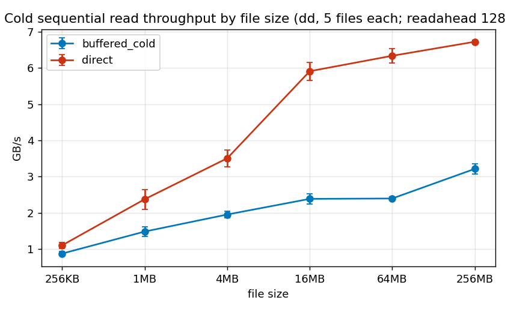
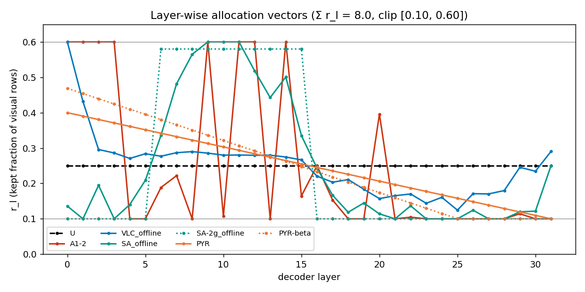

# Layer-wise budget v2 — Packed PrefixStore-KV25 + prior-work allocation baselines (LLaVA-NeXT) — results

Run `/home/dblab/hj/mllm_v2/runs/layer_budget_kv25_v2_20261106T073502Z`. Contract [CONTRACT.md](CONTRACT.md) (SHA `2898995f3097f700…`, frozen before measurement; v1 contract SHA `12993920bcf3f9f2…`). Model llava-v1.6-vicuna-7b NF4/BF16/eager, FP16 SSD KV, greedy max 16, seed 1234. v1 run: `results/layer_budget_kv25_20261105T125754Z` (PARTIAL).

## Decision: **GO**

HOLD followup accuracy, A1-2_packed − U_packed: **+1.305 pp** [+0.560, +2.046] (image-cluster paired bootstrap, 10,000 resamples, seed 1234; CI excludes 0). SSD MB/followup 308.050 vs uniform 308.050 (OK ≤1.02×); TTFT mean 215.62 vs 212.06 ms = 1.017× (OK ≤1.05×). Independent audit: PASS; final = True.

### v1 → v2

|  | v1 (unpacked, 65 preads) | v2 (packed, 1 preadv) |
|---|---|---|
| Verdict | PARTIAL | GO |
| A1-2 − U followup Δ pp [CI] | +1.305 [+0.560, +2.046] | +1.305 [+0.560, +2.046] |
| TTFT A1-2 / U | 1.124× | 1.017× |
| U TTFT mean ms | 248.94 | 212.06 (0.852× v1, cross-run) |
| A1-2 TTFT mean ms | 279.80 | 215.62 (0.771× v1, cross-run) |
| Packed TTFT spread across vectors vs U_packed | — | A1-2_packed +1.7%, VLC_offline_packed +1.2%, SA_offline_packed +2.2%, PYR_packed +1.6% (outside ±2 %) |

## Gates

| Gate | Result |
|---|---|
| cpu_tests | PASS |
| g3_budget_invariance | PASS |
| g8_vector_reproducibility | PASS |
| g9_io_microbench | PASS |
| gpu_gates | PASS |
| G3 DEV byte invariance (max |ratio−1|) | 0.000000 (tol 0.02) PASS |
| G6 DEV packed == unpacked outputs (U, A1-2, directcopy) | 660 checks, all identical = True (PASS) |
| Artifact protection before/after | PASS |

## G9 — cold sequential read throughput by file size (GNU dd; fio not installed)

| size | buffered cold GB/s (mean, min–max) | O_DIRECT GB/s (mean, min–max) |
|---|---|---|
| 256KB | 0.87 (0.78–0.95) | 1.10 (0.97–1.19) |
| 1MB | 1.48 (1.30–1.58) | 2.37 (1.93–2.65) |
| 4MB | 1.95 (1.81–2.05) | 3.51 (3.17–3.82) |
| 16MB | 2.38 (2.23–2.51) | 5.91 (5.55–6.15) |
| 64MB | 2.39 (2.35–2.46) | 6.34 (6.02–6.48) |
| 256MB | 3.21 (3.05–3.38) | 6.73 (6.69–6.79) |

## Allocation vectors (Σ r_l = 8.0, clip [0.10, 0.60])

| layer | U | A1-2 | VLC_offline | SA_offline | SA-2g_offline | PYR | PYR-beta | γ_l (VL-Cache) | cos_l (SA) |
|---|---|---|---|---|---|---|---|---|---|
| 0 | 0.250 | 0.600 | 0.600 | 0.136 | 0.100 | 0.400 | 0.469 | 0.272 | 0.9892 |
| 1 | 0.250 | 0.600 | 0.431 | 0.100 | 0.100 | 0.390 | 0.454 | 0.933 | 0.9944 |
| 2 | 0.250 | 0.600 | 0.296 | 0.195 | 0.100 | 0.381 | 0.439 | 0.954 | 0.9845 |
| 3 | 0.250 | 0.600 | 0.286 | 0.100 | 0.100 | 0.371 | 0.425 | 0.955 | 0.9925 |
| 4 | 0.250 | 0.100 | 0.271 | 0.140 | 0.100 | 0.361 | 0.410 | 0.958 | 0.9888 |
| 5 | 0.250 | 0.100 | 0.284 | 0.209 | 0.100 | 0.352 | 0.395 | 0.956 | 0.9834 |
| 6 | 0.250 | 0.189 | 0.277 | 0.336 | 0.580 | 0.342 | 0.380 | 0.957 | 0.9733 |
| 7 | 0.250 | 0.222 | 0.287 | 0.482 | 0.580 | 0.332 | 0.366 | 0.955 | 0.9617 |
| 8 | 0.250 | 0.100 | 0.290 | 0.565 | 0.580 | 0.323 | 0.351 | 0.955 | 0.9550 |
| 9 | 0.250 | 0.600 | 0.286 | 0.600 | 0.580 | 0.313 | 0.336 | 0.955 | 0.9497 |
| 10 | 0.250 | 0.107 | 0.280 | 0.600 | 0.580 | 0.303 | 0.321 | 0.956 | 0.9422 |
| 11 | 0.250 | 0.600 | 0.280 | 0.600 | 0.580 | 0.294 | 0.307 | 0.956 | 0.9429 |
| 12 | 0.250 | 0.600 | 0.280 | 0.519 | 0.580 | 0.284 | 0.292 | 0.956 | 0.9587 |
| 13 | 0.250 | 0.100 | 0.280 | 0.443 | 0.580 | 0.274 | 0.277 | 0.956 | 0.9648 |
| 14 | 0.250 | 0.600 | 0.275 | 0.501 | 0.580 | 0.265 | 0.263 | 0.957 | 0.9601 |
| 15 | 0.250 | 0.165 | 0.267 | 0.335 | 0.580 | 0.255 | 0.248 | 0.958 | 0.9733 |
| 16 | 0.250 | 0.250 | 0.220 | 0.243 | 0.100 | 0.245 | 0.233 | 0.966 | 0.9806 |
| 17 | 0.250 | 0.153 | 0.203 | 0.166 | 0.100 | 0.235 | 0.218 | 0.968 | 0.9868 |
| 18 | 0.250 | 0.100 | 0.211 | 0.119 | 0.100 | 0.226 | 0.204 | 0.967 | 0.9906 |
| 19 | 0.250 | 0.100 | 0.184 | 0.145 | 0.100 | 0.216 | 0.189 | 0.971 | 0.9885 |
| 20 | 0.250 | 0.396 | 0.157 | 0.114 | 0.100 | 0.206 | 0.174 | 0.975 | 0.9909 |
| 21 | 0.250 | 0.100 | 0.165 | 0.100 | 0.100 | 0.197 | 0.159 | 0.974 | 0.9944 |
| 22 | 0.250 | 0.105 | 0.170 | 0.137 | 0.100 | 0.187 | 0.145 | 0.973 | 0.9891 |
| 23 | 0.250 | 0.100 | 0.144 | 0.100 | 0.100 | 0.177 | 0.130 | 0.978 | 0.9951 |
| 24 | 0.250 | 0.100 | 0.161 | 0.100 | 0.100 | 0.168 | 0.115 | 0.975 | 0.9930 |
| 25 | 0.250 | 0.100 | 0.124 | 0.100 | 0.100 | 0.158 | 0.100 | 0.981 | 0.9967 |
| 26 | 0.250 | 0.100 | 0.171 | 0.124 | 0.100 | 0.148 | 0.100 | 0.973 | 0.9901 |
| 27 | 0.250 | 0.100 | 0.170 | 0.100 | 0.100 | 0.139 | 0.100 | 0.973 | 0.9961 |
| 28 | 0.250 | 0.100 | 0.180 | 0.100 | 0.100 | 0.129 | 0.100 | 0.972 | 0.9929 |
| 29 | 0.250 | 0.114 | 0.246 | 0.120 | 0.100 | 0.119 | 0.100 | 0.962 | 0.9905 |
| 30 | 0.250 | 0.100 | 0.234 | 0.122 | 0.100 | 0.110 | 0.100 | 0.963 | 0.9903 |
| 31 | 0.250 | 0.100 | 0.291 | 0.251 | 0.100 | 0.100 | 0.100 | 0.955 | 0.9800 |

Ratio SHA256: U `54ea273e1a38…`, A1-2 `2c2295cfbe87…`, VLC_offline `912fdc936aae…`, SA_offline `cf6cf739ddb5…`, SA-2g_offline `54587bef0bce…`, PYR `d4314f59fc8e…`, PYR-beta `e374616b5a02…`. Clipped layers: {"U": [], "A1-2": [0, 1, 2, 3, 4, 5, 8, 9, 11, 12, 13, 14, 18, 19, 21, 23, 24, 25, 26, 27, 28, 30, 31], "VLC_offline": [0], "SA_offline": [1, 3, 9, 10, 11, 21, 23, 24, 25, 27, 28], "SA-2g_offline": [0, 1, 2, 3, 4, 5, 16, 17, 18, 19, 20, 21, 22, 23, 24, 25, 26, 27, 28, 29, 30, 31], "PYR": [31], "PYR-beta": [26, 27, 28, 29, 30, 31]}. 

VLC_offline and SA_offline freeze the CAL mean of quantities that VL-Cache and SqueezeAttention compute online per request; they are allocation criteria moved offline, **not reproductions of the original systems**. PYR is the fixed-shape PyramidKV schedule (v1 F-front ratios); PYR-beta is the PyramidKV code schedule with β = 20. SA-2g uses the SqueezeAttention 3-cluster rule with class-3 budget = 0.100 (ASSUMPTION from the README example ratio; clipped to r_min). All comparisons share bytes, the packed I/O path and the VisionZip token order and differ only in the per-layer cut point.

## Phase 3 — DEV (40 images × 5 cache hits per arm = 200 hits; T1 shared; every arm from its own real store)

| Arm | Store | Hit acc. % | Δ vs A1-2_packed (pp) [95% CI] | Δ vs U_packed (pp) [95% CI] | Δ vs FullLoad (pp) [95% CI] |
|---|---|---|---|---|---|
| recompute | none | 63.000 | +3.50 [+0.00, +7.50] | +6.50 [+1.50, +12.00] | +0.00 [-2.00, +2.00] |
| fullload | raster | 63.000 | +3.50 [-0.50, +8.00] | +6.50 [+1.50, +12.00] | — |
| U_unpacked | prefix25 | 56.500 | -3.00 [-8.00, +2.00] | +0.00 [+0.00, +0.00] | -6.50 [-12.00, -1.50] |
| A1-2_unpacked | prefix25_layerwise | 59.500 | +0.00 [+0.00, +0.00] | +3.00 [-2.00, +8.00] | -3.50 [-8.00, +0.50] |
| U_packed | packed | 56.500 | -3.00 [-8.00, +2.00] | — | -6.50 [-12.00, -1.50] |
| A1-2_packed | packed | 59.500 | — | +3.00 [-2.00, +8.00] | -3.50 [-8.00, +0.50] |
| VLC_offline_packed | packed | 57.000 | -2.50 [-6.50, +1.00] | +0.50 [-3.50, +4.50] | -6.00 [-11.00, -1.50] |
| SA_offline_packed | packed | 38.000 | -21.50 [-32.50, -10.50] | -18.50 [-29.50, -7.50] | -25.00 [-35.50, -14.50] |
| SA-2g_offline_packed | packed | 35.500 | -24.00 [-35.00, -13.00] | -21.00 [-32.00, -10.00] | -27.50 [-38.00, -17.00] |
| PYR_packed | packed | 56.500 | -3.00 [-7.50, +1.50] | +0.00 [-3.50, +3.50] | -6.50 [-11.50, -2.00] |
| PYR-beta_packed | packed | 56.000 | -3.50 [-7.50, +0.50] | -0.50 [-5.00, +4.00] | -7.00 [-12.00, -2.50] |
| A1-2_packed_directcopy | packed | 59.500 | +0.00 [+0.00, +0.00] | +3.00 [-2.00, +8.00] | -3.50 [-8.00, +0.50] |

| Arm | Repeats | TTFT mean ± SD(repeat means) / p50 / p95 ms | read ms | scatter ms | SSD MB/hit | pread / preadv calls |
|---|---|---|---|---|---|---|
| recompute | 1 | 520.9 ± 0.0 / 526.3 / 594.5 | — | — | 0.00 | 0 / 0 |
| fullload | 1 | 719.8 ± 0.0 / 705.1 / 895.0 | — | — | 1165.07 | 64 / 0 |
| U_unpacked | 3 | 225.4 ± 0.9 / 224.7 / 266.1 | 127.7 | 55.2 | 306.29 | 65 / 0 |
| A1-2_unpacked | 3 | 256.5 ± 5.0 / 254.2 / 306.9 | 156.3 | 57.5 | 306.29 | 65 / 0 |
| U_packed | 3 | 180.8 ± 0.6 / 181.1 / 213.4 | 83.9 | 55.4 | 306.29 | 0 / 1 |
| A1-2_packed | 3 | 182.3 ± 0.1 / 182.4 / 213.6 | 83.1 | 57.4 | 306.29 | 0 / 1 |
| VLC_offline_packed | 3 | 177.9 ± 0.7 / 179.9 / 202.7 | 80.6 | 55.2 | 306.29 | 0 / 1 |
| SA_offline_packed | 3 | 177.7 ± 0.7 / 179.5 / 203.6 | 79.2 | 56.5 | 306.29 | 0 / 1 |
| SA-2g_offline_packed | 1 | 178.2 ± 0.0 / 177.6 / 211.6 | 79.9 | 56.4 | 306.29 | 0 / 1 |
| PYR_packed | 3 | 176.3 ± 0.7 / 176.9 / 212.3 | 79.4 | 55.2 | 306.29 | 0 / 1 |
| PYR-beta_packed | 1 | 173.1 ± 0.0 / 174.0 / 197.2 | 75.9 | 55.3 | 306.29 | 0 / 1 |
| A1-2_packed_directcopy | 3 | 180.1 ± 0.9 / 181.2 / 212.8 | 82.3 | 55.9 | 306.29 | 0 / 1 |

Packed / unpacked TTFT: U 0.802×, A1-2 0.711×; A1-2 / U: unpacked 1.138×, packed 1.008×; directcopy / scatter (A1-2 packed) 0.988×. Packed TTFT spread vs U_packed: A1-2_packed +0.8%, VLC_offline_packed -1.6%, SA_offline_packed -1.7%, SA-2g_offline_packed -1.5%, PYR_packed -2.5%, PYR-beta_packed -4.3%.

| Store | Store MB/image | Persistence ms mean / p95 | Native writer SSD write ms | packed SHA256 ms | Activation ms | OS write MB |
|---|---|---|---|---|---|---|
| fullload | 1260.58 | 1775.6 / 2694.7 | 453.3 | 0.0 | 651.1 | 1260.58 |
| U_unpacked | 309.02 | 639.3 / 903.9 | 109.4 | 0.0 | 162.7 | 309.02 |
| A1-2_unpacked | 309.03 | 625.7 / 823.4 | 107.2 | 0.0 | 163.3 | 309.03 |
| U_packed | 309.01 | 705.4 / 898.2 | 107.4 | 120.7 | 177.5 | 309.01 |
| A1-2_packed | 309.02 | 708.7 / 900.0 | 106.0 | 120.8 | 178.0 | 309.02 |
| VLC_offline_packed | 309.02 | 716.5 / 907.7 | 106.5 | 121.0 | 176.7 | 309.02 |
| SA_offline_packed | 309.02 | 710.7 / 893.0 | 104.5 | 120.9 | 175.6 | 309.02 |
| SA-2g_offline_packed | 309.02 | 702.9 / 955.6 | 102.1 | 120.2 | 174.1 | 309.02 |
| PYR_packed | 309.01 | 699.5 / 882.8 | 103.4 | 120.6 | 173.7 | 309.01 |
| PYR-beta_packed | 309.01 | 698.5 / 854.2 | 102.5 | 120.6 | 172.7 | 309.01 |

Question-type Δ vs FullLoad on hits (pp), spatial highlighted:

| type | n | U_packed | A1-2_packed | VLC_offline_packed | SA_offline_packed | SA-2g_offline_packed | PYR_packed | PYR-beta_packed | U_unpacked | A1-2_unpacked |
|---|---|---|---|---|---|---|---|---|---|---|
| all | 200 | -6.5 | -3.5 | -6.0 | -25.0 | -27.5 | -6.5 | -7.0 | -6.5 | -3.5 |
| color | 10 | -10.0 | -10.0 | -10.0 | -50.0 | -50.0 | -10.0 | -10.0 | -10.0 | -10.0 |
| material/attribute | 8 | +25.0 | +25.0 | +25.0 | -25.0 | -12.5 | +12.5 | +0.0 | +25.0 | +25.0 |
| object | 50 | -8.0 | -6.0 | -10.0 | -18.0 | -20.0 | -10.0 | -10.0 | -8.0 | -6.0 |
| other | 6 | +0.0 | +0.0 | +0.0 | -50.0 | -66.7 | +0.0 | +0.0 | +0.0 | +0.0 |
| **spatial** | 43 | -9.3 | -7.0 | -4.7 | -25.6 | -25.6 | -2.3 | -4.7 | -9.3 | -7.0 |
| yes/no | 83 | -7.2 | -2.4 | -7.2 | -24.1 | -28.9 | -8.4 | -7.2 | -7.2 | -2.4 |

SELECTED = A1-2 (fixed before measurement); best DEV vector = A1-2_packed (comparison only). HOLD arms: ['recompute', 'fullload', 'ours_prefixstore_kv25_U_packed', 'ours_prefixstore_kv25_A1-2_packed', 'ours_prefixstore_kv25_VLC_offline_packed', 'ours_prefixstore_kv25_SA_offline_packed', 'ours_prefixstore_kv25_PYR_packed'].

## Phase 4 — HOLD (MT-GQA-reconstructed, 398 images, 4,061 dialogues × 3 turns, generated history, 7 arms)

Independent audit PASS: 85281 / 85281 requests, 398 / 398 images.

| Method | T1 % | T2 % | T3 % | All % (correct/N) | Followup % (correct/N) |
|---|---|---|---|---|---|
| ReComp | 63.186 | 68.111 | 68.850 | 66.716 (8128/12183) | 68.481 (5562/8122) |
| FullLoad | 63.186 | 68.062 | 68.702 | 66.650 (8120/12183) | 68.382 (5554/8122) |
| U_packed | 63.186 | 65.698 | 66.658 | 65.181 (7941/12183) | 66.178 (5375/8122) |
| A1-2_packed | 63.186 | 67.126 | 67.840 | 66.051 (8047/12183) | 67.483 (5481/8122) |
| VLC_offline_packed | 63.186 | 66.757 | 67.348 | 65.764 (8012/12183) | 67.052 (5446/8122) |
| SA_offline_packed | 63.186 | 63.999 | 65.846 | 64.344 (7839/12183) | 64.922 (5273/8122) |
| PYR_packed | 63.186 | 66.658 | 67.570 | 65.805 (8017/12183) | 67.114 (5451/8122) |

### Prior-work comparison (HOLD followup, same bytes, same packed path)

| Vector (packed) | Followup % | Δ vs U_packed pp [CI] | Δ vs A1-2_packed pp [CI] | TTFT mean ms (× U_packed) | SSD MB/followup | read calls |
|---|---|---|---|---|---|---|
| U_packed | 66.178 | 0 (control) | -1.305 [-2.046, -0.560] | 212.06 (1.000×) | 308.05 | 1 |
| A1-2_packed | 67.483 | +1.305 [+0.560, +2.046] | 0 (SELECTED) | 215.62 (1.017×) | 308.05 | 1 |
| VLC_offline_packed | 67.052 | +0.874 [+0.302, +1.459] | -0.431 [-0.965, +0.094] | 214.62 (1.012×) | 308.05 | 1 |
| SA_offline_packed | 64.922 | -1.256 [-1.985, -0.524] | -2.561 [-3.382, -1.748] | 216.75 (1.022×) | 308.05 | 1 |
| PYR_packed | 67.114 | +0.936 [+0.440, +1.438] | -0.369 [-0.933, +0.203] | 215.44 (1.016×) | 308.05 | 1 |

| a − b | Scope | Δ pp [95% CI] | a-only / b-only / both / neither | Pred. agreement |
|---|---|---|---|---|
| A1-2_packed − U_packed | followup | +1.305 [+0.560, +2.046] | 373 / 267 / 5108 / 2374 | 88.845 |
| A1-2_packed − U_packed | all | +0.870 [+0.373, +1.364] | 373 / 267 / 7674 / 3869 | 92.563 |
| A1-2_packed − VLC_offline_packed | followup | +0.431 [-0.094, +0.965] | 196 / 161 / 5285 / 2480 | 93.573 |
| A1-2_packed − VLC_offline_packed | all | +0.287 [-0.063, +0.644] | 196 / 161 / 7851 / 3975 | 95.715 |
| A1-2_packed − SA_offline_packed | followup | +2.561 [+1.748, +3.382] | 495 / 287 / 4986 / 2354 | 86.173 |
| A1-2_packed − SA_offline_packed | all | +1.707 [+1.165, +2.255] | 495 / 287 / 7552 / 3849 | 90.782 |
| A1-2_packed − PYR_packed | followup | +0.369 [-0.203, +0.933] | 230 / 200 / 5251 / 2441 | 92.293 |
| A1-2_packed − PYR_packed | all | +0.246 [-0.136, +0.622] | 230 / 200 / 7817 / 3936 | 94.862 |
| VLC_offline_packed − U_packed | followup | +0.874 [+0.302, +1.459] | 296 / 225 / 5150 / 2451 | 91.024 |
| VLC_offline_packed − U_packed | all | +0.583 [+0.201, +0.973] | 296 / 225 / 7716 / 3946 | 94.016 |
| SA_offline_packed − U_packed | followup | -1.256 [-1.985, -0.524] | 301 / 403 / 4972 / 2446 | 87.651 |
| SA_offline_packed − U_packed | all | -0.837 [-1.324, -0.349] | 301 / 403 / 7538 / 3941 | 91.767 |
| PYR_packed − U_packed | followup | +0.936 [+0.440, +1.438] | 235 / 159 / 5216 / 2512 | 93.105 |
| PYR_packed − U_packed | all | +0.624 [+0.293, +0.959] | 235 / 159 / 7782 / 4007 | 95.403 |
| U_packed − ReComp | followup | -2.302 [-3.052, -1.540] | 297 / 484 / 5078 / 2263 | 86.727 |
| U_packed − ReComp | all | -1.535 [-2.035, -1.027] | 297 / 484 / 7644 / 3758 | 91.152 |
| U_packed − FullLoad | followup | -2.204 [-2.951, -1.451] | 307 / 486 / 5068 / 2261 | 86.543 |
| U_packed − FullLoad | all | -1.469 [-1.968, -0.967] | 307 / 486 / 7634 / 3756 | 91.028 |
| A1-2_packed − ReComp | followup | -0.997 [-1.663, -0.341] | 220 / 301 / 5261 / 2340 | 90.803 |
| A1-2_packed − ReComp | all | -0.665 [-1.109, -0.228] | 220 / 301 / 7827 / 3835 | 93.869 |
| A1-2_packed − FullLoad | followup | -0.899 [-1.588, -0.249] | 229 / 302 / 5252 / 2339 | 90.557 |
| A1-2_packed − FullLoad | all | -0.599 [-1.059, -0.166] | 229 / 302 / 7818 / 3834 | 93.704 |
| VLC_offline_packed − ReComp | followup | -1.428 [-2.021, -0.846] | 210 / 326 / 5236 / 2350 | 90.372 |
| VLC_offline_packed − ReComp | all | -0.952 [-1.347, -0.564] | 210 / 326 / 7802 / 3845 | 93.581 |
| VLC_offline_packed − FullLoad | followup | -1.330 [-1.936, -0.727] | 232 / 340 / 5214 / 2336 | 89.855 |
| VLC_offline_packed − FullLoad | all | -0.886 [-1.290, -0.485] | 232 / 340 / 7780 / 3831 | 93.236 |
| SA_offline_packed − ReComp | followup | -3.558 [-4.407, -2.703] | 308 / 597 / 4965 / 2252 | 83.982 |
| SA_offline_packed − ReComp | all | -2.372 [-2.938, -1.802] | 308 / 597 / 7531 / 3747 | 89.321 |
| SA_offline_packed − FullLoad | followup | -3.460 [-4.287, -2.626] | 319 / 600 / 4954 / 2249 | 83.772 |
| SA_offline_packed − FullLoad | all | -2.306 [-2.858, -1.750] | 319 / 600 / 7520 / 3744 | 89.182 |
| PYR_packed − ReComp | followup | -1.367 [-2.009, -0.732] | 243 / 354 / 5208 / 2317 | 89.436 |
| PYR_packed − ReComp | all | -0.911 [-1.340, -0.488] | 243 / 354 / 7774 / 3812 | 92.957 |
| PYR_packed − FullLoad | followup | -1.268 [-1.922, -0.631] | 263 / 366 / 5188 / 2305 | 88.981 |
| PYR_packed − FullLoad | all | -0.845 [-1.281, -0.421] | 263 / 366 / 7754 / 3800 | 92.654 |
| FullLoad − ReComp | followup | -0.098 [-0.337, +0.143] | 44 / 52 / 5510 / 2516 | 98.449 |
| FullLoad − ReComp | all | -0.066 [-0.224, +0.095] | 44 / 52 / 8076 / 4011 | 98.966 |

| Method | TTFT mean / p50 / p95 ms | E2E mean / p50 / p95 ms | read ms | scatter ms | SSD MB/followup | pread / preadv |
|---|---|---|---|---|---|---|
| ReComp | 531.17 / 533.21 / 596.55 | 559.76 / 563.40 / 644.16 | — | — | 0.00 | 0 / 0 |
| FullLoad | 762.42 / 755.15 / 917.44 | 791.56 / 785.54 / 947.16 | — | — | 1173.92 | 64 / 0 |
| U_packed | 212.06 / 212.78 / 239.01 | 241.10 / 237.93 / 285.91 | 83.0 | 82.6 | 308.05 | 0 / 1 |
| A1-2_packed | 215.62 / 215.28 / 242.32 | 244.81 / 240.41 / 293.50 | 84.5 | 84.8 | 308.05 | 0 / 1 |
| VLC_offline_packed | 214.62 / 213.68 / 245.45 | 243.74 / 240.31 / 290.46 | 85.9 | 82.3 | 308.05 | 0 / 1 |
| SA_offline_packed | 216.75 / 216.03 / 246.71 | 245.99 / 243.29 / 293.30 | 86.2 | 83.4 | 308.05 | 0 / 1 |
| PYR_packed | 215.44 / 215.77 / 244.15 | 244.58 / 243.38 / 288.42 | 86.7 | 81.6 | 308.05 | 0 / 1 |

| Method | Stored content % | Store MB mean / p50 / p95 | OS write MB | Persistence ms mean / p95 (native writer) | Activation ms mean / p95 |
|---|---|---|---|---|---|
| FullLoad | 100.000 | 1264.67 / 1304.80 / 1382.31 | 1264.67 | 1637.4 / 2048.3 (996.7) | 1251.9 / 1392.2 |
| U_packed | 25.000 | 309.67 / 320.44 / 338.01 | 309.67 | 685.3 / 846.7 (518.3) | 184.4 / 204.2 |
| A1-2_packed | 25.000 | 309.67 / 320.45 / 338.02 | 309.67 | 690.7 / 837.5 (522.6) | 185.2 / 206.6 |
| VLC_offline_packed | 25.000 | 309.67 / 320.45 / 338.02 | 309.67 | 679.8 / 823.0 (512.5) | 185.2 / 206.9 |
| SA_offline_packed | 25.000 | 309.67 / 320.45 / 338.02 | 309.67 | 675.4 / 821.7 (507.2) | 186.4 / 207.5 |
| PYR_packed | 25.000 | 309.67 / 320.45 / 338.01 | 309.67 | 675.4 / 823.0 (507.8) | 187.4 / 208.3 |

| Method | Shared-stream session mean / p50 / p95 ms | Standalone-equivalent mean / p50 / p95 ms | Provenance |
|---|---|---|---|
| ReComp | 1670.3 / 1700.7 / 1895.7 | 1670.3 / 1700.7 / 1895.7 | MEASURED_NO_KV_SETUP |
| FullLoad | 2418.3 / 2150.1 / 5048.9 | 5029.8 / 5037.6 / 5769.8 | MEASURED (shared) / DERIVED (standalone) |
| U_packed | 1118.4 / 1047.9 / 1918.7 | 1906.1 / 1912.3 / 2206.3 | MEASURED (shared) / DERIVED (standalone) |
| A1-2_packed | 1125.8 / 1052.4 / 1927.7 | 1919.3 / 1930.0 / 2180.2 | MEASURED (shared) / DERIVED (standalone) |
| VLC_offline_packed | 1122.6 / 1050.7 / 1909.1 | 1906.4 / 1913.3 / 2223.1 | MEASURED (shared) / DERIVED (standalone) |
| SA_offline_packed | 1126.8 / 1057.2 / 1913.7 | 1906.5 / 1914.6 / 2209.3 | MEASURED (shared) / DERIVED (standalone) |
| PYR_packed | 1124.2 / 1057.1 / 1916.1 | 1906.2 / 1917.3 / 2185.2 | MEASURED (shared) / DERIVED (standalone) |

| a − b | Scope / metric | Δ [95% CI] |
|---|---|---|
| A1-2_packed − U_packed | followup / ttft_ms | +3.560 [+2.797, +4.349] |
| A1-2_packed − U_packed | followup / request_e2e_ms | +3.706 [+2.924, +4.520] |
| A1-2_packed − U_packed | followup / ssd_read_bytes | +0.000 [+0.000, +0.000] |
| A1-2_packed − VLC_offline_packed | followup / ttft_ms | +1.002 [+0.289, +1.707] |
| A1-2_packed − VLC_offline_packed | followup / request_e2e_ms | +1.068 [+0.341, +1.787] |
| A1-2_packed − VLC_offline_packed | followup / ssd_read_bytes | +0.000 [+0.000, +0.000] |
| A1-2_packed − SA_offline_packed | followup / ttft_ms | -1.129 [-1.948, -0.313] |
| A1-2_packed − SA_offline_packed | followup / request_e2e_ms | -1.181 [-2.054, -0.304] |
| A1-2_packed − SA_offline_packed | followup / ssd_read_bytes | +0.000 [+0.000, +0.000] |
| A1-2_packed − PYR_packed | followup / ttft_ms | +0.177 [-0.819, +1.195] |
| A1-2_packed − PYR_packed | followup / request_e2e_ms | +0.223 [-0.797, +1.253] |
| A1-2_packed − PYR_packed | followup / ssd_read_bytes | +0.000 [+0.000, +0.000] |
| VLC_offline_packed − U_packed | followup / ttft_ms | +2.558 [+1.742, +3.393] |
| VLC_offline_packed − U_packed | followup / request_e2e_ms | +2.638 [+1.813, +3.486] |
| VLC_offline_packed − U_packed | followup / ssd_read_bytes | +0.000 [+0.000, +0.000] |
| SA_offline_packed − U_packed | followup / ttft_ms | +4.689 [+3.767, +5.621] |
| SA_offline_packed − U_packed | followup / request_e2e_ms | +4.887 [+3.932, +5.857] |
| SA_offline_packed − U_packed | followup / ssd_read_bytes | +0.000 [+0.000, +0.000] |
| PYR_packed − U_packed | followup / ttft_ms | +3.383 [+2.353, +4.432] |
| PYR_packed − U_packed | followup / request_e2e_ms | +3.482 [+2.441, +4.548] |
| PYR_packed − U_packed | followup / ssd_read_bytes | +0.000 [+0.000, +0.000] |
| U_packed − ReComp | followup / ttft_ms | -319.112 [-325.002, -313.228] |
| U_packed − ReComp | followup / request_e2e_ms | -318.655 [-324.528, -312.797] |
| U_packed − ReComp | followup / ssd_read_bytes | +308049732.901 [+304173517.804, +311984792.205] |
| U_packed − FullLoad | followup / ttft_ms | -550.364 [-558.320, -542.798] |
| U_packed − FullLoad | followup / request_e2e_ms | -550.460 [-558.427, -542.906] |
| U_packed − FullLoad | followup / ssd_read_bytes | -865869184.536 [-876788752.815, -854999351.081] |
| A1-2_packed − ReComp | followup / ttft_ms | -315.552 [-321.174, -309.802] |
| A1-2_packed − ReComp | followup / request_e2e_ms | -314.949 [-320.566, -309.180] |
| A1-2_packed − ReComp | followup / ssd_read_bytes | +308049732.901 [+304173517.804, +311984792.205] |
| A1-2_packed − FullLoad | followup / ttft_ms | -546.804 [-554.588, -539.288] |
| A1-2_packed − FullLoad | followup / request_e2e_ms | -546.754 [-554.557, -539.259] |
| A1-2_packed − FullLoad | followup / ssd_read_bytes | -865869184.536 [-876788752.815, -854999351.081] |
| VLC_offline_packed − ReComp | followup / ttft_ms | -316.554 [-322.283, -310.794] |
| VLC_offline_packed − ReComp | followup / request_e2e_ms | -316.017 [-321.718, -310.271] |
| VLC_offline_packed − ReComp | followup / ssd_read_bytes | +308049732.901 [+304173517.804, +311984792.205] |
| VLC_offline_packed − FullLoad | followup / ttft_ms | -547.806 [-555.790, -540.216] |
| VLC_offline_packed − FullLoad | followup / request_e2e_ms | -547.822 [-555.809, -540.199] |
| VLC_offline_packed − FullLoad | followup / ssd_read_bytes | -865869184.536 [-876788752.815, -854999351.081] |
| SA_offline_packed − ReComp | followup / ttft_ms | -314.423 [-320.097, -308.760] |
| SA_offline_packed − ReComp | followup / request_e2e_ms | -313.768 [-319.408, -308.112] |
| SA_offline_packed − ReComp | followup / ssd_read_bytes | +308049732.901 [+304173517.804, +311984792.205] |
| SA_offline_packed − FullLoad | followup / ttft_ms | -545.675 [-553.608, -538.069] |
| SA_offline_packed − FullLoad | followup / request_e2e_ms | -545.573 [-553.495, -537.975] |
| SA_offline_packed − FullLoad | followup / ssd_read_bytes | -865869184.536 [-876788752.815, -854999351.081] |
| PYR_packed − ReComp | followup / ttft_ms | -315.728 [-321.639, -309.920] |
| PYR_packed − ReComp | followup / request_e2e_ms | -315.172 [-321.055, -309.366] |
| PYR_packed − ReComp | followup / ssd_read_bytes | +308049732.901 [+304173517.804, +311984792.205] |
| PYR_packed − FullLoad | followup / ttft_ms | -546.981 [-554.964, -539.298] |
| PYR_packed − FullLoad | followup / request_e2e_ms | -546.978 [-554.981, -539.263] |
| PYR_packed − FullLoad | followup / ssd_read_bytes | -865869184.536 [-876788752.815, -854999351.081] |
| FullLoad − ReComp | followup / ttft_ms | +231.253 [+227.555, +235.175] |
| FullLoad − ReComp | followup / request_e2e_ms | +231.805 [+228.118, +235.732] |
| FullLoad − ReComp | followup / ssd_read_bytes | +1173918917.437 [+1159221569.656, +1188777787.868] |
| FullLoad − ReComp | session_shared / session_ms | +748.024 [+732.398, +765.441] |
| FullLoad − ReComp | session_standalone / session_ms | +3359.478 [+3317.305, +3403.105] |
| U_packed − ReComp | session_shared / session_ms | -551.889 [-563.721, -539.928] |
| U_packed − ReComp | session_standalone / session_ms | +235.760 [+228.318, +243.405] |
| A1-2_packed − ReComp | session_shared / session_ms | -544.500 [-555.961, -532.831] |
| A1-2_packed − ReComp | session_standalone / session_ms | +248.998 [+242.054, +255.899] |
| VLC_offline_packed − ReComp | session_shared / session_ms | -547.710 [-559.235, -535.910] |
| VLC_offline_packed − ReComp | session_standalone / session_ms | +236.089 [+229.517, +243.038] |
| SA_offline_packed − ReComp | session_shared / session_ms | -543.524 [-554.986, -531.746] |
| SA_offline_packed − ReComp | session_standalone / session_ms | +236.139 [+229.306, +243.247] |
| PYR_packed − ReComp | session_shared / session_ms | -546.074 [-557.885, -534.184] |
| PYR_packed − ReComp | session_standalone / session_ms | +235.902 [+228.677, +243.172] |

### v1 HOLD reference (cross-run, unpacked)

| v1 method | Followup % | TTFT mean ms | SSD MB/followup | preads |
|---|---|---|---|---|
| ReComp | 68.481 | 529.27 | 0.00 | 0 |
| FullLoad | 68.382 | 736.50 | 1173.92 | 64 |
| B-uniform | 66.178 | 248.94 | 308.05 | 65 |
| B-A1-2 | 67.483 | 279.80 | 308.05 | 65 |

## Limits and NOT_MEASURED

- Paired CIs: seed 1234, 10,000 image-cluster bootstrap resamples; a CI containing 0 is not equivalence. DEV has 40 image clusters and all DEV images are inside HOLD (different questions).
- VLC_offline / SA_offline are offline CAL-mean vectorisations of online criteria, not reproductions of VL-Cache / SqueezeAttention; no official VL-Cache code was available (definitions from the paper). PYR / PYR-beta reproduce fixed-shape schedules only.
- Packed serving keeps LLaVA's dense GPU buffer and the v1 scatter; no GPU-memory reduction is claimed. H2D bytes, independent GPU footprint, NAND-level coldness, O_DIRECT serving (G9 shows it would be faster) are NOT_MEASURED / not implemented. Qwen2.5-VL and GLM were not run.
- v1 → v2 TTFT comparisons are cross-run (different days, same machine); only within-run paired comparisons carry CIs.
- Existing sources: ["scripts/157_report_layer_budget_kv25.py"] changed vs the v1 HOLD freeze (recorded: {"scripts/157_report_layer_budget_kv25.py": "v1 report script edited after the v1 HOLD freeze (v1 REPORT protection PASS); not imported by v2"}); v2 only adds modules.

## Execution record (appended after the automated report; local time KST = UTC+9)

| Phase | Window | Actual work | Failed / skipped attempts |
|---|---|---|---|
| 0 contract freeze (161 freeze, storage plan, v1 SHA checks) | 2026-11-06 16:35 → 16:47 | contract SHA `2898995f…`, protection baseline 4,601 files | — |
| 1 prior-work vectors (158) | 16:47 → 17:00 | 1,250 CAL questions × 1 full-prompt forward each (VL-Cache γ, SqueezeAttention cos), 5 vectors + U/A1-2 copies, G8 PASS (max Δ 2e-14) | one 3-image probe aborted on the 1,250-record assert (expected) |
| 2 gates (161 g9 / cpu / gpu) | 16:48 → 17:10 | G9 dd microbench 6 sizes × 5 reps buffered + O_DIRECT; CPU suite incl. tests/test_packed_store.py (4 tests); GPU gates 5 sample cases PASS (G1/G2/G4/G6/G7) (packed == unpacked bitwise, 1 preadv / 0 pread) | gpu attempt 1 PASS but archived (receipt lacked `packed_sha256_ms` → meta timing added, amendment); gpu attempt 2 FAILED at case 5 (capacity reserve, 20 GB of gate stores retained → amendment: per-case store deletion) |
| 3 DEV (159) | 17:11 → 17:58 | SMOKE + GQA 40/240 PASS, 6,120 OK rows (T1 shared + 13 arms × 200 hits + latency repeats), G3 byte invariance 0.0, G6 660 output checks identical | smoke attempts 1–3 FAILED (T1_source label; prefix25 `k_per_layer` KeyError; stale dev store), attempt 4 PASS before the cache-release fix; GQA attempt 1 FAILED (CUDA OOM after 4 images) → `hit_arm` releases `PrefixCache.k/v`; all recorded as freeze_amendment_*.json and re-frozen |
| 4 HOLD freeze + smoke (162) | 17:58 → 18:00 | 7 methods frozen (config sha `70066d8b…`), storage plan PASS, smoke 84 / 84 requests, audit PASS | — |
| 4 HOLD main (162) | 2026-11-06 18:00:53 → 2026-11-07 06:43:47 (12.71 h, 45,774 s) | **85,281 / 85,281 requests, 398 / 398 images, 0 failed, 0 skipped**, independent per-image audit PASS (398 cleanup receipts, 126 run-local files removed per image) | none; no resume needed |
| 5 report (160) | 06:48 → 06:55 | REPORT.md, decision.json (GO, final), independent_audit.json PASS (85,281), paired_analysis, protection after PASS (4,601 files unchanged) | first run raised `TypeError: numpy.bool_` in decide() → cast fix, amendment `freeze_amendment_report_script_numpy_bool.json`, re-run |

Total wall-clock 2026-11-06 16:35 → 2026-11-07 06:55 KST ≈ 14.3 h, of which HOLD main 12.7 h.

**Cross-run equivalence (added check, `v1_v2_prediction_equivalence.json`):** the 48,732 HOLD requests shared with v1 (U, A1-2, ReComp, FullLoad; same dialogues, turns and generated history) produced **0 prediction differences** between v1 unpacked (65 preads) and v2 packed (1 preadv) serving — which is why the v2 Δ and CI coincide with v1 to the last digit. The verdict change PARTIAL → GO comes entirely from the TTFT bound (1.124× → 1.017×) under the unified read path.

**Existing artefacts:** no pre-existing store, run or results directory was modified or deleted (protection before/after SHA + stat inventory PASS). Deleted run-local only: `llava/gpu_gates_attempt1`, `llava/gpu_gates` gate stores (21.4 GB, amendment), stale `llava/dev_stores/smoke`, and the per-image `hold/scratch` stores after each image's audit (allowlisted receipts).

**NOT_MEASURED / not implemented:** H2D bytes and an independent GPU footprint (the dense GPU buffer + v1 scatter are unchanged, no memory saving claimed); NAND-level cold reads (page cache dropped with DONTNEED only); O_DIRECT serving (G9 only shows it would read faster); fio (GNU dd used); sklearn KMeans (exact 1-D 3-means used for SA-2g); Qwen2.5-VL and GLM arms; v1 ↔ v2 TTFT ratios are cross-run and carry no CI.
