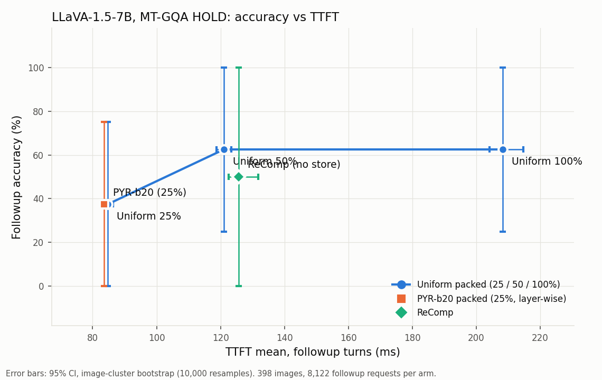

# LLaVA-1.5-7B 포팅 + MT-GQA HOLD (ReComp / U100 / U50 / U25 / PYR-b20 packed)

Run `runs/llava15_mt_gqa_dev_20261112T0613Z`. 계약 [CONTRACT.md](CONTRACT.md) (SHA `e7c8405f6027a89e…`, gate·smoke·main 전에 freeze). 단위: MB = 10^6 B, ms, 정확도 차이는 pp. followup = T2–T3. CI = 이미지 단위 paired bootstrap 95% (10,000회, seed 1234).

상태: **REHEARSAL_NOT_A_RESULT** — main 60 / 60 요청(arm당 12), 이미지 4 / 398, 실패·스킵 0, 독립 감사 PASS, T1 arm 간 토큰 일치 4 / 4 (PASS).

## 이 실험에서 반드시 알아야 할 것

- **LLaVA-1.5-7B는 이미지당 시각 토큰이 576개로 고정이고 KV는 약 302 MB(301,989,888 B, FP16, 32 layer × K·V × 576행 × 8,192 B)이며 separator가 없다.** 전처리는 HF 기본 processor 그대로다(CLIPImageProcessor: 짧은 변 336 resize 후 336×336 중앙 자르기). 원 LLaVA-1.5 저장소는 정사각형 패딩이라 공개 GQA 수치와 조건이 다르다.
- **모든 packed arm은 같은 중요도 순서(CLIP 끝에서 두 번째 layer의 CLS→patch attention head 합, 내림차순 stable 정렬)와 같은 I/O 경로(이미지당 파일 1개, hit당 preadv 1회, dense 버퍼 + layer별 mask)를 쓰고, 비율과 layer별 자르는 지점만 다르다.** 질문은 선택에 쓰지 않는다. 데이터로 무엇을 맞추거나 고르지 않았다.
- **PYR-b20은 PyramidKV 공개 코드 식(β=20)의 layer 비율 그대로이며 attention 기반 token 선택은 쓰지 않았다.** 총 바이트는 U25와 같다.
- **LLaVA-NeXT의 100% packed 지점은 측정된 적이 없다.** (B)의 LLaVA-NeXT 참고값은 다른 I/O 경로(파일 분리)의 값이다.
- **MT-VQA·Qwen·GLM·LLaVA-NeXT는 이번에 실행하지 않았다.** 참고값은 선행 run의 기록이다. 절대 TTFT는 실행 간 비교하지 않는다.
- 주 운영점은 25%로 실행 전에 고정했다. 50%·100%는 곡선의 점이다.

## (D) 곡선 — HOLD followup

| Arm | 비율 | layer당 행 | Followup % [95% CI] | vs ReComp Δpp [CI] | TTFT mean / p50 / p95 ms | TTFT / ReComp | SSD MB / followup |
|---|---|---|---|---|---|---|---|
| ReComp | – | – | 50.000 [0.000, 100.000] | – | 125.70 / 134.56 / 136.45 | 1.000× | 0.00 |
| U100_packed | 100% | 576 | 62.500 [25.000, 100.000] | +12.500 [+0.000, +37.500] | 208.29 / 205.70 / 218.48 | 1.657× | 301.99 |
| U50_packed | 50% | 288 | 62.500 [25.000, 100.000] | +12.500 [+0.000, +37.500] | 121.06 / 120.70 / 124.84 | 0.963× | 150.99 |
| U25_packed | 25% | 144 | 37.500 [0.000, 75.000] | -12.500 [-37.500, +0.000] | 84.77 / 84.27 / 87.25 | 0.674× | 75.50 |
| PYR-b20_packed | 25% | 281…7 (합 4,608) | 37.500 [0.000, 75.000] | -12.500 [-37.500, +0.000] | 83.54 / 83.64 / 85.13 | 0.665× | 75.50 |

Δ는 (행의 arm − ReComp)이다. CI가 0을 포함하면 '차이 미입증'이며 동등하다는 뜻이 아니다. T1은 모든 arm이 full pixel이고, 차이는 generated history가 갈라지는 효과를 포함한다.

## (A) 주 운영점 — U25_packed vs ReComp

| 항목 | 값 |
|---|---|
| Followup 정확도 | U25 37.500% vs ReComp 50.000% |
| Δ pp [95% CI] | -12.500 [-37.500, +0.000] — 차이 미입증 |
| 원래 성능 대비 | 75.00% |
| TTFT mean / p50 / p95 ms | U25 84.77 / 84.27 / 87.25  vs  ReComp 125.70 / 134.56 / 136.45 |
| TTFT 비율 (mean) [95% CI] | 0.674× [0.656, 0.688] (단축 32.6%); p50 0.626×, p95 0.639× |
| SSD MB / followup | 75.50 |

## (B) KV 크기 축 지표 (보고, 판정 아님)

| 지표 | 정의 | LLaVA-1.5-7B (이 실행) [95% CI] | Qwen2.5-VL (같은 packed 경로) | LLaVA-NeXT-7B (v1, 파일 분리 경로) |
|---|---|---|---|---|
| R100 | TTFT(U100) / TTFT(ReComp) | **1.657** [1.552, 1.748] | 0.462 | 1.39 |
| S25 | TTFT(U25) / TTFT(U100) | **0.407** [0.394, 0.421] | 0.892 | 0.34 |
| S50 | TTFT(U50) / TTFT(U100) | **0.581** [0.571, 0.595] | – | – |
| 이미지당 KV (100%) |  | 302 MB | 약 22 MB | 약 1,174 MB |

사전 기록 가설: R100은 0.462와 1.39 사이 → **틀림** (관측 1.657). S25는 0.34와 0.892 사이 → **맞음** (관측 0.407). Qwen2.5-VL 값은 같은 packed 경로(22 MB/이미지). LLaVA-NeXT-7B 값은 v1 run의 파일 분리 경로(100% = FullLoad 65 pread, 25% = unpacked)이며 LLaVA-NeXT의 100% packed 지점은 측정된 적이 없어 직접 비교가 아니다. 절대 TTFT는 실행 간 비교하지 않는다.

## (C) layer 배분 판정 — PYR-b20_packed − U25_packed

| 판정 | Δ pp [95% CI] | CI의 0 | SSD MB/followup (PYR / U25, ≤1.02×) | TTFT 평균 ms (PYR / U25, ≤1.05×) | PYR만 / U25만 / 둘 다 / 둘 다 오답 | 예측 일치율 |
|---|---|---|---|---|---|---|
| **NO-GO** | +0.000 [+0.000, +0.000] | 포함 (차이 미입증) | 75.497 / 75.497 (OK) | 83.54 / 84.77 = 0.986× (OK) | 0 / 0 / 3 / 5 | 100.00% |

규칙(실행 전 고정, LLaVA-NeXT·Qwen과 동일): GO = Δ ≥ +1.0 pp & CI 0 제외 & SSD MB ≤ U25 × 1.02 & TTFT 평균 ≤ U25 × 1.05; PARTIAL = Δ ≥ +0.5 pp이고 CI 0 포함, 또는 GO에서 MB/TTFT 중 정확히 하나 위반; 그 외 NO-GO. 같은 규칙의 선행 결과: LLaVA-NeXT-7B GO (+1.244 pp, PYR-beta-raw vs U_packed), Qwen2.5-VL NO-GO (-0.899 pp).

## 정확도 (turn별) — (F) T1 정상성 포함

| Arm | T1 % | T2 % | T3 % | All % (정답/N) | Followup % (정답/N) |
|---|---|---|---|---|---|
| ReComp | 50.000 | 50.000 | 50.000 | 50.000 (6/12) | 50.000 (4/8) |
| U100_packed | 50.000 | 75.000 | 50.000 | 58.333 (7/12) | 62.500 (5/8) |
| U50_packed | 50.000 | 75.000 | 50.000 | 58.333 (7/12) | 62.500 (5/8) |
| U25_packed | 50.000 | 50.000 | 25.000 | 41.667 (5/12) | 37.500 (3/8) |
| PYR-b20_packed | 50.000 | 50.000 | 25.000 | 41.667 (5/12) | 37.500 (3/8) |

T1은 모든 arm이 full pixel이다. arm 간 T1 생성 토큰 일치: 4 / 4 요청 → PASS. T1 정확도는 공개 LLaVA-1.5-7B GQA 수치(61.9)와 양자화(NF4)·전처리(중앙 자르기)·멀티턴 프롬프트 구성·398장 재구성 표본이 달라 직접 비교가 아니며 판정에 쓰지 않는다.

| 비교 (A − B) | Followup Δpp [95% CI] | All Δpp [95% CI] | T2 Δpp | T3 Δpp | A만 / B만 정답 (followup) | 예측 일치율 (followup) |
|---|---|---|---|---|---|---|
| U25_packed − ReComp | -12.500 [-37.500, +0.000] | -8.333 [-25.000, +0.000] | +0.000 | -25.000 | 0 / 1 | 87.50% |
| U50_packed − ReComp | +12.500 [+0.000, +37.500] | +8.333 [+0.000, +25.000] | +25.000 | +0.000 | 1 / 0 | 87.50% |
| U100_packed − ReComp | +12.500 [+0.000, +37.500] | +8.333 [+0.000, +25.000] | +25.000 | +0.000 | 1 / 0 | 87.50% |
| PYR-b20_packed − ReComp | -12.500 [-37.500, +0.000] | -8.333 [-25.000, +0.000] | +0.000 | -25.000 | 0 / 1 | 87.50% |
| PYR-b20_packed − U25_packed | +0.000 [+0.000, +0.000] | +0.000 [+0.000, +0.000] | +0.000 | +0.000 | 0 / 0 | 100.00% |
| U50_packed − U25_packed | +25.000 [+0.000, +50.000] | +16.667 [+0.000, +33.333] | +25.000 | +25.000 | 2 / 0 | 75.00% |
| U100_packed − U50_packed | +0.000 [+0.000, +0.000] | +0.000 [+0.000, +0.000] | +0.000 | +0.000 | 0 / 0 | 100.00% |
| U100_packed − U25_packed | +25.000 [+0.000, +50.000] | +16.667 [+0.000, +33.333] | +25.000 | +25.000 | 2 / 0 | 75.00% |

## Followup 성능과 I/O

| Arm | TTFT mean / p50 / p95 ms | E2E mean / p95 ms | TTFT / ReComp | TTFT / U100 | SSD MB | 읽기 호출 (pread / preadv) | peak GPU alloc MB (평균) | T1 TTFT mean ms |
|---|---|---|---|---|---|---|---|---|
| ReComp | 125.70 / 134.56 / 136.45 | 150.35 / 164.37 | 1.000× | 0.603× | 0.00 | 0 / 0 | 4577.3 | 109.78 |
| U100_packed | 208.29 / 205.70 / 218.48 | 233.45 / 264.54 | 1.657× | 1.000× | 301.99 | 0 / 1 | 4806.7 | 109.05 |
| U50_packed | 121.06 / 120.70 / 124.84 | 145.93 / 170.16 | 0.963× | 0.581× | 150.99 | 0 / 1 | 4806.7 | 109.00 |
| U25_packed | 84.77 / 84.27 / 87.25 | 112.04 / 136.79 | 0.674× | 0.407× | 75.50 | 0 / 1 | 4806.7 | 109.04 |
| PYR-b20_packed | 83.54 / 83.64 / 85.13 | 110.74 / 134.66 | 0.665× | 0.401× | 75.50 | 0 / 1 | 4806.7 | 108.94 |

## (E) 구간별 시간 (followup 평균 ms)

| Arm | 입력 준비 (prompt·tokenize / 이미지 전처리) | read (preadv 1회) | H2D·scatter·mask | cache 할당 등 | prefill | decode |
|---|---|---|---|---|---|---|
| ReComp | 4.57 (processor 전체) | – | – | – | 118.83 (vision + 전체 prefill) | 24.52 |
| U100_packed | 0.74 | 85.89 | 83.26 | 3.27 | 35.06 (suffix) | 24.96 |
| U50_packed | 0.73 | 41.14 | 41.32 | 3.27 | 34.54 (suffix) | 24.73 |
| U25_packed | 0.70 | 22.20 | 24.01 | 3.22 | 34.56 (suffix) | 27.12 |
| PYR-b20_packed | 0.67 | 21.39 | 23.64 | 3.24 | 34.54 (suffix) | 27.06 |

구간은 TTFT의 구성 요소지만 계측 경계가 달라 합이 TTFT와 정확히 같지는 않다. H2D와 scatter는 HOLD 경로에서 한 호출(`PrefixCache.write`)이라 분리하지 않았다. 아래는 gate fixture 10장(turn 3)에서 계측용 복제 경로로 잰 분해이며 **HOLD 측정이 아닌 진단값**이다(복제 결과는 production cache와 bitwise 동일).

| Vector | host FP16→BF16 변환 | H2D 복사 | GPU index write | mask | (참고) 같은 fixture의 production scatter | H2D MB |
|---|---|---|---|---|---|---|
| U100 | 53.85 | 16.85 | 2.55 | 1.63 | 76.46 | 301.99 |
| U50 | 27.45 | 9.33 | 2.18 | 1.63 | 40.50 | 150.99 |
| U25 | 13.71 | 5.82 | 1.98 | 1.60 | 23.78 | 75.50 |
| PYR-b20 | 13.69 | 5.47 | 1.96 | 1.61 | 23.29 | 75.50 |

## 저장과 setup (이미지당 1회)

| Arm | 보존 % | 파일 수 | store MB / 이미지 | persistence mean / p50 / p95 ms | writer ms (materialize·repack / write / fsync·rename) | 완료 hash ms | activation mean / p50 / p95 ms |
|---|---|---|---|---|---|---|---|
| U100_packed | 100.0 | 5 | 304.65 | 511.1 / 490.7 / 569.0 | 350.8 (39.0 / 101.5 / 81.0) | 147.3 | 201.3 / 178.6 / 258.3 |
| U50_packed | 50.0 | 5 | 153.65 | 290.6 / 272.4 / 339.1 | 204.3 (40.6 / 51.9 / 45.7) | 76.9 | 103.7 / 93.1 / 131.2 |
| U25_packed | 25.0 | 5 | 78.15 | 164.7 / 154.2 / 190.5 | 122.3 (38.0 / 22.8 / 27.3) | 41.5 | 56.6 / 50.9 / 71.0 |
| PYR-b20_packed | 25.0 | 5 | 78.16 | 168.1 / 157.8 / 194.6 | 126.0 (38.8 / 25.0 / 27.3) | 41.3 | 56.3 / 50.3 / 70.7 |

persistence = Turn-1 capture에서 store-ready(fsync + atomic rename)까지 + 완료 봉인(전체 SHA256 1회). activation = 메타 검증 + payload SHA256 전체 검증 + pinned buffer 할당. 네 store는 각 arm 자신의 T1 capture에서 만들었고 순서표는 이미지마다 네 store가 동일하다(감사).

## 3-turn session

| Arm | setup ms / 이미지 | shared-stream mean / p50 / p95 ms | standalone-equivalent (DERIVED) mean / p50 / p95 ms |
|---|---|---|---|
| ReComp | 0.0 | 439.5 / 424.8 / 487.7 | 439.5 / 424.8 / 487.7 |
| U100_packed | 712.4 | 1317.1 / 1248.6 / 1493.1 | 1317.1 / 1248.6 / 1493.1 |
| U50_packed | 394.3 | 824.1 / 775.3 / 949.9 | 824.1 / 775.3 / 949.9 |
| U25_packed | 221.3 | 583.0 / 554.2 / 667.4 | 583.0 / 554.2 / 667.4 |
| PYR-b20_packed | 224.3 | 583.8 / 552.3 / 668.8 | 583.8 / 552.3 / 668.8 |

| A − B | accounting | Δ ms [95% CI] |
|---|---|---|
| U25_packed − ReComp | shared | +143.6 [+126.9, +173.7] |
| U25_packed − ReComp | standalone | +143.6 [+126.9, +173.7] |
| U50_packed − ReComp | shared | +384.6 [+338.0, +452.9] |
| U50_packed − ReComp | standalone | +384.6 [+338.0, +452.9] |
| U100_packed − ReComp | shared | +877.6 [+808.1, +988.4] |
| U100_packed − ReComp | standalone | +877.6 [+808.1, +988.4] |
| PYR-b20_packed − U25_packed | shared | +0.7 [-2.4, +3.3] |
| PYR-b20_packed − U25_packed | standalone | +0.7 [-2.4, +3.3] |

shared-stream은 이미지의 첫 dialogue에만 setup(persistence + activation)을 더한 실측 합이다. standalone-equivalent는 모든 dialogue에 setup을 더한 DERIVED 값이다.

## Gate

| Gate | 결과 | 내용 |
|---|---|---|
| LG1 runner 동치 | PASS | 새 runner recompute 경로 == HF generate(greedy, max 16), fixture 10장 × 3턴 토큰 전부 동일 |
| LG2 geometry·순서 | PASS | 시각 span 576개 연속 1구간, separator 0, CLS saliency (1, 576) 유한, 순서 = 0..575 순열, 질문을 바꿔도·다시 실행해도 순열 SHA 동일, LLM 호출 0 |
| LG3 capture 정확성 | PASS | T1 capture의 prefix KV == 질문 자리를 filler로 바꾼 같은 길이의 독립 forward(3종), 32 layer K/V bitwise. 문자 그대로의 짧은 prefix-only forward(진단): layer 0만 bitwise, layer ≥ 1은 최대 rel-L2 0.0147 |
| LG4 저장 정확성 | PASS | packed 파일의 layer slice == capture → FP16 → 순서표 앞 k_l행 (bitwise), 파일 크기 = 기대 바이트(separator 0 B), 변조 meta·SHA·행 수·잘린 파일 거부 |
| LG5 hit 경로 구현 | PASS | SSD 경로 / 같은 shape의 독립 in-memory 참조 / 반복 실행: 첫 logits bitwise 동일, 생성 ID 동일, layer별 가시 행 == 순서표 앞 k_l개 (mask bit 비교) |
| LG6 의미 검증 | PASS | 전체 길이 참조(576행 실제 값 + layer별 가시 집합 mask) vs production: FP32 첫 토큰 logits atol = rtol = 1e-4. U100 vs recompute 첫 토큰 일치 29 / 30 (96.7%, 기준 95%) |
| LG7 I/O | PASS | hit당 preadv 1회·pread 0회, 반환 바이트 = 파일 크기, vision 0·score 0, 질문만 바꿔도 read range·선택 ID 불변 |
| LG8 CPU | PASS | 벡터 SHA·합, N = 576에서 Σ k_l = 32·ceil(r·576), layer_budget 기본값에 기대는 호출 0, fail-closed 검사 75건(negative fixture 포함) |
| LG9 회귀 | PASS | 기존 CPU 테스트 전체 통과(Ran 568 tests in 11.134s), GLM 기존 실패 3건 분리 보고, 기존 소스 무수정 |
| LG10 통합 | PASS | smoke dialogue 5 arm × 3턴 generated history 60 요청 + 독립 재감사 |
| Artifact protection before/after | PASS | SHA 4841 → 4841 files, kvstore inventory 16160, 다른 run inventory 1858839 |
| Deletion log | PASS | run-local scratch / gate store만 삭제, 기존 runs·results·stores 삭제 0 |

U100 vs recompute 첫 토큰 불일치(원인 기록): n204894 T2 (U100 top-2 logit 차 0.1250). U100은 T1의 prefix KV(FP16 왕복)에 suffix만 prefill하고 recompute는 전체를 prefill하므로 BF16 반올림이 shape에 따라 달라져 동률에 가까운 첫 토큰이 뒤집힐 수 있다.

진단(비 gate): 같은 가시 집합을 원래 token 순서로 배치한 참조와 production의 첫 토큰 logits 최대 차 0.2500, 첫 토큰 일치 119 / 120, 생성 ID 일치 119 / 120 (key 합산 순서에 따른 BF16 반올림).

## 실행 기록

- 실제 요청 수: main 60 / 60 (5 arm × 12,183), smoke 60 / 60, integration(LG10) 60 / 60. 실패·스킵 요청 0. 실패 attempt 기록 0건, 중단 기록 0건.
- main 소요: 0.01 h (첫 시작 → 완료, wall). freeze 시 예상 3–6 h.
- 삭제: main scratch store 4개 이미지 · 파일 80개 · 2.5 GB(정확한 SHA allowlist 후), gate store 10개 이미지. 기존 runs/results/stores 삭제 0.
- freeze amendment: freeze_amendment_1.json, freeze_amendment_2.json.
- 환경: 3.10.20, transformers 4.57.6, bitsandbytes 0.49.2, torch 2.5.1+cu121, 모델 revision `b234b804b114d9e37bb655e11cbbb5f5e971b7a9`.

## 프롬프트와 다르게 한 점

1. LG3: 프롬프트의 '독립적인 prefix-only forward'를 문자 그대로(길이 P의 짧은 forward) 구현하면 BF16 GEMM 반올림이 tensor shape에 의존해 layer ≥ 1에서 bitwise가 성립하지 않는다(개발 probe에서 확인, 저장소 선례 scripts/30·docs/recompute_kv25_ablation_contract.md). freeze 전에 계약에서 LG3 참조를 '질문 자리를 filler 토큰으로 바꾼 같은 길이의 독립 forward(3종)'로 정의했다. bitwise·전 layer·K/V 기준은 그대로다. 문자 그대로의 짧은 forward는 LG3-literal 진단으로 실행해 수치만 기록했다(gate 아님).
2. LG6: '전체 길이 참조'는 576행이 모두 실제 값인 cache에 layer별 가시 집합을 mask로만 적용한 독립 구현이며, 행 배치는 production과 같은 저장 순서다(기존 LLaVA G2와 같은 배치·같은 1e-4 기준). 원래 token 순서로 배치한 변형은 key 합산 순서가 달라 BF16 반올림 수준의 차이가 생기므로 진단으로만 기록했다(gate 아님).
3. (E)의 H2D와 scatter는 HOLD 경로에서 분리 측정하지 않았다. hit 경로는 LLaVA-NeXT와 같은 `PrefixCache.write`(FP16→BF16 변환 + H2D + index write가 한 호출)를 그대로 쓰므로 HOLD 수치는 'H2D·scatter·mask' 합산이다. 분해 수치는 gate fixture 10장에서 계측용 복제 경로로 잰 진단값이다(HOLD 측정이 아님).
4. HOLD 프롬프트는 프롬프트 1절의 단일 턴 템플릿이 아니라 '기존 멀티턴 형식'(LLaVA-NeXT HOLD 164와 같은 `Current question Q{t}` 형식)을 모든 턴에 썼다. 단일 턴 템플릿은 runner.prompt()에 기록만 했다.
5. PYR-b20 벡터 문서: PyramidKV run의 PYR-beta-raw json을 그대로 복사해 보관하고 ratio만 가져왔다(새로 계산하지 않음, ratio SHA 동일). 복사본의 clip 범위는 [0.0, 0.6]이지만 프롬프트 지시대로 모든 layer_budget 호출은 r_min=0.0, r_max=1.0을 명시한다. 최대 ratio가 0.4875라 k_l은 두 범위에서 같다(Phase 0에서 확인).
6. 실행 환경: conda env mllm_ft의 Python을 절대 경로로 호출했다(셸 PATH의 python은 다른 venv). transformers 4.57.6 / bitsandbytes 0.49.2 / torch 2.5.1+cu121.
7. 개발 rehearsal: 공식 freeze 전에 gate fixture 이미지로 코드 동작을 확인했다(runs/llava15_mt_gqa_dev_*; 측정이 아니며 보고 수치에 쓰지 않음).

freeze amendment 기록: [freeze_amendment_1.json](freeze_amendment_1.json), [freeze_amendment_2.json](freeze_amendment_2.json)

## 한계와 NOT_MEASURED

- HOLD 경로에서 H2D 단독 시간(합산 측정; 분해는 fixture 진단)
- NAND/controller 수준 cold read, O_DIRECT (DONTNEED는 page-cache hint)
- 독립 GPU footprint
- LLaVA-NeXT 100% packed 지점
- MT-VQA / Qwen / GLM / LLaVA-NeXT (이번에 실행하지 않음)
- FullLoad(파일 분리) arm
- PyramidKV의 attention 기반 token 선택
- DONTNEED는 OS page-cache hint이며 NAND cold나 O_DIRECT가 아니다.
- CI가 0을 포함한다는 것은 동등성 증명이 아니다(이미지 398개 cluster bootstrap). 곡선과 (B)·(C)는 HOLD에서 관찰한 값이며 다른 데이터에서 확인되지 않았다.
- packed serving은 dense GPU 버퍼를 유지하므로 GPU 메모리 절감은 주장하지 않는다.
